# Практическая работа №7: Основные типы данных и безопасность типов в Dart

## Тема 1. Числовые типы: int, double, num и математические операции

### Задание 1

**Конвертер валют:** Напишите функцию, принимающую сумму в рублях (`int`) и курс доллара (`double`), возвращающую строку с результатом, отформатированным строго до 2 знаков после запятой.

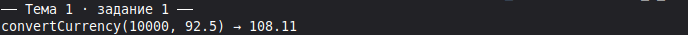

### Задание 2

**Безопасный калькулятор возраста:** Примите ввод пользователя в виде `String`. Используя `int.tryParse()`, верните возраст или `-1`, если пользователь ввел некорректный текст.

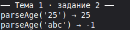

### Задание 3

**Расчет плотности пикселей (DP):** Реализуйте формулу `dp = px / density` с использованием оператора целочисленного или дробного деления.

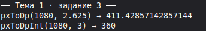

### Задание 4

**Побитовые флаги сенсоров:** Используя побитовые операторы `&`, `|` и `<<`, закодируйте состояние трех мобильных датчиков в одну переменную `int`.

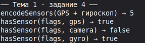

### Задание 5

**Проверка четности без остатка от деления:** Проверьте, является ли целое число четным, используя побитовое умножение `(number & 1) == 0`.

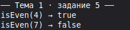

## Тема 2. Строки (String), интерполяция и кодовые точки (Runes)

### Задание 1

**Маскирование email:** Напишите функцию, преобразующую `ivanov.flutter@gmail.com` в `i************r@gmail.com`.

### Задание 2

**Валидатор префикса ссылки:** Проверьте, начинается ли переданная строка с безопасного протокола `https://` с помощью метода `.startsWith()`.

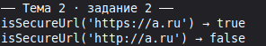

### Задание 3

**Генератор инициалов (Monogram):** Примите строку из двух слов («Александр Пушкин») и верните заглавные буквы «АП».

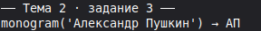

### Задание 4

**Разбор CSV-строки корзины:** Разбейте строку вида `"Яблоко,3,150.5"` методом `.split(',')` и извлеките наименование, количество и стоимость.

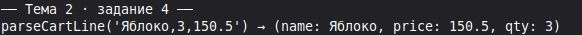

### Задание 5

**Подсчет реальной длины строки с эмодзи:** Напишите утилиту, которая считает точное количество символов в тексте с комбинированными эмодзи (через `.runes`).

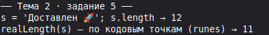

## Тема 3. Логический тип (bool) и строгость условий

### Задание 1

**Проверка права доступа к экрану:** Сформируйте булево выражение: пользователь авторизован, подтвердил email и не находится в списке заблокированных.

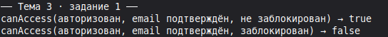

### Задание 2

**Определитель пустоты строки:** Напишите функцию `bool isBlank(String? input)`, возвращающую `true`, если строка равна `null`, пуста или состоит только из пробелов.

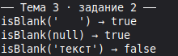

### Задание 3

**Тоггл состояния (Инвертор):** Напишите функцию, переключающую флаг темной темы `isDarkMode` на противоположное значение.

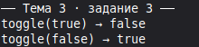

### Задание 4

**Валидатор возраста для аренды авто:** Проверьте совокупность условий: возраст \(\ge 21\) года И стаж вождения \(\ge 2\) лет.

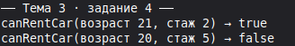

### Задание 5

**Строгая фильтрация коллекций:** Напишите проверку, что баланс пользователя строго положителен, избегая неявных сравнений.

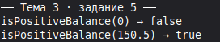

## Тема 4. Списки (List): списковые включения и spread-операторы

### Задание 1

**Удаление дубликатов с сохранением порядка:** Дан список `List<int>` с повторами. Верните список уникальных элементов через `.toSet().toList()`.

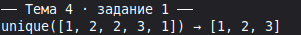

### Задание 2

**Пагинация среза (Slice):** Реализуйте метод `getPage(List<T> list, int page, int pageSize)`, возвращающий соответствующий подсписок с помощью `.sublist()`.

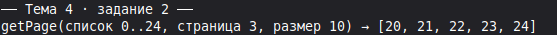

### Задание 3

**Сортировка товаров по цене:** Дан список цен `List<double>`. Отсортируйте его по убыванию с помощью метода `.sort()`.

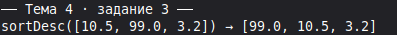

### Задание 4

**Поиск первого подходящего элемента:** Найдите в списке строк первое слово длиннее 8 символов с помощью `.firstWhere()`, обработав случай отсутствия через `orElse`.

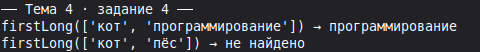

### Задание 5

**Генератор виджетов через List.generate:** Создайте список строк вида `["Слот 1", "Слот 2", ... "Слот 10"]` с помощью конструктора `List.generate()`.

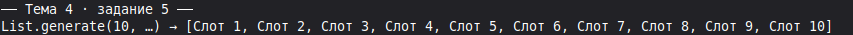

## Тема 5. Множества (Set) и Словари (Map): парсинг JSON-структур

### Задание 1

**Подсчет частоты слов:** Дана строка текста. С помощью `Map<String, int>` подсчитайте, сколько раз каждое слово встречается в тексте.

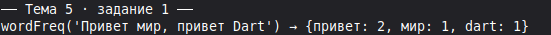

### Задание 2

**Симметрическая разность тегов:** Найдите теги, которые присутствуют только в одном из двух множеств `Set<String>`, но не в обоих одновременно.

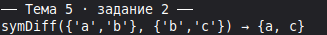

### Задание 3

**Безопасное извлечение настроек:** Напишите функцию, извлекающую значение `String` из вложенной `Map<String, dynamic>` с гарантированным возвратом дефолтного значения при отсутствии ключа.

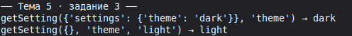

### Задание 4

**Трансформация карты (Map Entries):** Преобразуйте `Map<String, double>` с ценами в рублях в карту с ценами в долларах с помощью `.map()`.

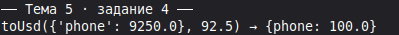

### Задание 5

**Группировка пользователей по городу:** Дан список карт пользователей. Сгруппируйте их в структуру `Map<String, List<Map<String, dynamic>>>`.

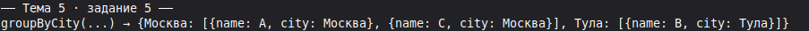

## Тема 6. Null Safety, Records (кортежи) и Pattern Matching

### Задание 1

**Координаты экрана через Record:** Напишите функцию, возвращающую кортеж `(double x, double y)` центра экрана смартфона.

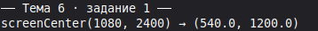

### Задание 2

**Безопасная распаковка профиля:** Дана переменная `String? bio`. Если она `null`, запишите в переменную `displayBio` текст «Информация отсутствует».

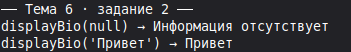

### Задание 3

**Pattern Matching над JSON:** Используя конструкцию `switch (json)`, проверьте формат входящего пакета: валидный объект с `id` или объект с полем ошибки.

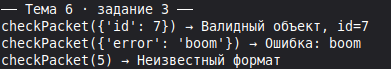

### Задание 4

**Служебная переменная с `late`:** Объявите переменную `late final double expensiveCalculation`, которая вычисляется только при первом реальном обращении.

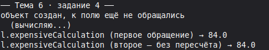

### Задание 5

**Безопасный поиск в списке:** Извлеките первый элемент списка `List<int>? numbers` через операторы `?.[0]` и `?? -1`.

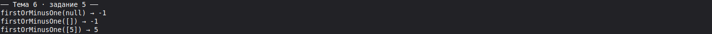

## 50 Смешанных заданий по обработке данных

### Блок 1: Числа, финансы и расчеты корзины (1–10)

#### Задание 1

**Калькулятор скидки с промокодом:** Рассчитайте итоговую стоимость заказа при условии: скидка 15%, но не более 500 рублей.

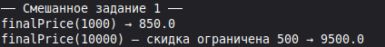

#### Задание 2

**Форматирование цены по стандарту валют:** Преобразуйте число `15400900.5` в строку `"15 400 900.50 ₽"`.

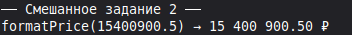

#### Задание 3

**Расчет кешбэка баллами:** Начислите 1 балл за каждые полные 100 рублей чека, используя оператор целочисленного деления `~/`.

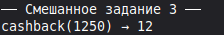

#### Задание 4

**Ограничитель диапазона (Clamp):** Напишите функцию, ограничивающую уровень громкости динамика в диапазоне от `0.0` до `1.0`.

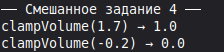

#### Задание 5

**Конвертер байтов в мегабайты:** Преобразуйте размер файла из байтов в МБ с округлением до одного знака после запятой.

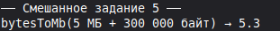

#### Задание 6

**Вычисление процентного прогресса:** По текущему шагу `current` и общему числу шагов `total` верните `double` от `0.0` до `1.0`.

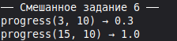

#### Задание 7

**Округление до ближайшего десятка:** Округлите переданное число вверх до ближайшего числа, кратного 10 (например, `43` -> `50`).

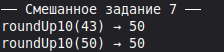

#### Задание 8

**Калькулятор стоимости доставки:** Базовая ставка 200 руб. + 30 руб. за каждый километр свыше 5 км.

#### Задание 9

**Проверка делимости без остатка:** Определите, делится ли размер скачиваемого пакета ровно на блоки по 1024 байта.

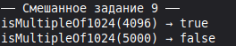

#### Задание 10

**Парсер диапазона цен:** Извлеките минимальную и максимальную цену из строки `"1500 - 4500 руб"`.

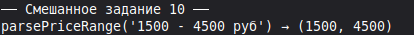

### Блок 2: Строки, валидация полей и парсинг текста (11–20)

#### Задание 11

**Валидатор пароля на регулярных выражениях:** Проверьте пароль на наличие минимум 8 символов, одной цифры и одной заглавной буквы.

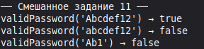

#### Задание 12

**Очистка поискового ввода:** Удалите из поискового запроса двойные пробелы, спецсимволы `#`, `$`, `%` и приведите к нижнему регистру.

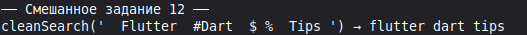

#### Задание 13

**Генератор сокращенного имени автора:** Преобразуйте `"Иванов Иван Иванович"` в `"Иванов И. И."`.

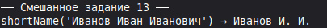

#### Задание 14

**Парсинг HEX-цвета для Flutter:** Преобразуйте строку вида `"#FF5722"` в целочисленное значение цвета `int` (`0xFFFF5722`).

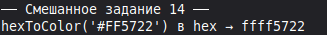

#### Задание 15

**Форматирование таймера звонка:** Переведите количество секунд `int seconds = 125` в строку вида `"02:05"`.

#### Задание 16

**Скрытие номера телефона:** Преобразуйте `"+79991234567"` в `"+7 (999) ***-**-67"`.

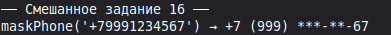

#### Задание 17

**Определитель языка текста (Кириллица/Латиница):** Определите, содержит ли строка символы русского алфавита с помощью проверки диапазонов кодовых точек.

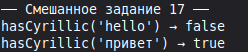

#### Задание 18

**Генератор слага (Slugify):** Преобразуйте заголовок статьи `"Быстрый старт во Flutter!"` в `"bystryi-start-vo-flutter"`.

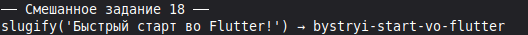

#### Задание 19

**Подсчет слов в заметке:** Подсчитайте количество слов в тексте заметки, разделенных пробелами и переносами строк.

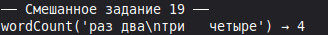

#### Задание 20

**Выделение тегов из текста:** Извлеките все хештеги из сообщения блога (слова, начинающиеся с `#`).

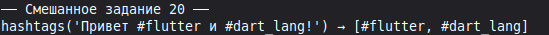

### Блок 3: Списки, пагинация и фильтрация каталога (21–30)

#### Задание 21

**Фильтр каталога по диапазону цен:** Из списка карточек товаров отберите только те, у которых цена находится в заданном диапазоне.

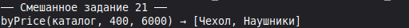

#### Задание 22

**Удаление завершенных задач из To-Do списка:** Отфильтруйте список задач, оставив только элементы со статусом `isCompleted == false`.

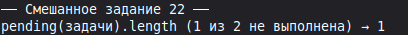

#### Задание 23

**Инверсия порядка чатов:** Разверните список сообщений без создания промежуточных копий в памяти.

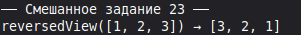

#### Задание 24

**Склейка двух списков баннеров:** Объедините системные промо-акции и персональные предложения с помощью spread-оператора `...`.

#### Задание 25

**Поиск максимального элемента без библиотек:** Найдите товар с наивысшим рейтингом в списке с помощью метода `.reduce()`.

#### Задание 26

**Чередование элементов списка:** Вставьте рекламный баннер после каждого 5-го элемента ленты новостей.

#### Задание 27

**Проверка идентичности двух списков:** Напишите функцию, проверяющую, содержат ли два списка одинаковые элементы на тех же позициях.

#### Задание 28

**Извлечение уникальных категорий:** Из списка всех товаров магазина сформируйте `List<String>` уникальных названий категорий.

#### Задание 29

**Сортировка списка по нескольким полям:** Отсортируйте список товаров сначала по доступности на складе, а затем по возрастанию цены.

#### Задание 30

**Постраничная группировка (Chunking):** Разбейте длинный список из 100 элементов на пачки (страницы) по 10 элементов.

### Блок 4: Map, JSON-сериализация и кэширование (31–40)

#### Задание 31

**Десериализация профиля:** Напишите парсер словаря `Map<String, dynamic>` в безопасные локальные переменные с дефолтными значениями.

#### Задание 32

**Конвертация списка в ассоциативную карту:** Преобразуйте `List<User>` в `Map<int, User>`, где ключом выступает уникальный `id`.

#### Задание 33

**Слияние локального и серверного профиля:** Объедините настройки приложения из кэша и свежие настройки с бэкенда с приоритетом сервера.

#### Задание 34

**Удаление ключей с null-значениями:** Очистите словарь от всех пар, где значение равно `null`, перед отправкой POST-запроса.

#### Задание 35

**Кэш экранов (LRU-концепт):** Реализуйте простейшую карту последних 5 открытых страниц, удаляя самый старый элемент при переполнении.

#### Задание 36

**Инверсия карты (Значения становятся ключами):** Поменяйте местами ключи и значения в словаре `Map<String, String>` (гарантируя уникальность).

#### Задание 37

**Подсчет суммы товаров по категориям:** На основе списка покупок верните `Map<String, double>`, где ключ — категория, а значение — общая сумма затрат.

#### Задание 38

**Валидация обязательных JSON-полей:** Проверьте, содержит ли карта ответа сервера ключи `"status"`, `"data"` и `"timestamp"`.

#### Задание 39

**Построение дерева категорий:** Преобразуйте плоский список категорий с `parentId` в иерархическую карту подкатегорий.

#### Задание 40

**Сериализация параметров фильтра в URL:** Соберите из словаря `{"brand": "Apple", "minPrice": 50000}` строку параметров `brand=Apple&minPrice=50000`.

### Блок 5: Sound Null Safety, Records и архитектурные пайплайны (41–50)

#### Задание 41

**Парсер геолокации через Record:** Напишите функцию, принимающую строку `"54.01, 38.29"` и возвращающую кортеж `(double lat, double lon)?`.

#### Задание 42

**Резолвер состояний загрузки (Pattern Matching):** С помощью `switch` верните текст сообщения для состояний `(isLoading: true, hasError: false)`, `(isLoading: false, hasError: true)` и `(isLoading: false, hasError: false)`.

#### Задание 43

**Безопасная цепочка вызовов (Deep Null Traversal):** Считайте улицу из вложенного объекта компании: `user?.company?.address?.street ?? "Адрес не указан"`.

#### Задание 44

**Сопоставление типа ответа API:** Напишите функцию обработки ответа через сопоставление типов: `case int code`, `case String error`, `case Map data`.

#### Задание 45

**Деструктуризация координат точки в цикле:** Пройдитесь по списку кортежей `List<(int x, int y)>` с прямой деструктуризацией `for (var (x, y) in points)`.

#### Задание 46

**Обмен значений двух переменных без третьей:** Поменяйте местами значения переменных `a` и `b` с помощью синтаксиса кортежей: `(a, b) = (b, a)`.

#### Задание 47

**Валидатор комплексной формы регистрации:** Функция возвращает Record `({bool isValid, List<String> errors})` с перечнем всех найденных ошибок формы.

#### Задание 48

**Обработка диапазона громкости через Switch Guard:** Используйте паттерн с условием `when`: `case int v when v > 80 => "Слишком громко!"`.

#### Задание 49

**Пайплайн очистки телефонной книги:** Дан список `List<String?>` с поврежденными записями. Очистите его от `null`, пустых строк и верните `Set<String>` уникальных нормализованных номеров.

#### Задание 50

**Итоговый аналитический модуль корзины:**

- Примите корзину покупок в виде `List<Map<String, dynamic>>`.
- Рассчитайте общую стоимость позиций с учетом индивидуальных скидок.
- Выделите категории товаров и проверьте бесплатность доставки (от 2000 руб.).
- Верните результат в виде именованного кортежа `({double total, double discountAmount, bool isFreeDelivery})`.

