# Практическая работа №8: Объектно-ориентированное программирование в Dart

## Тема 1. Классы, инкапсуляция, методы и геттеры/сеттеры

### Задание 1

**Инкапсулированный термостат:** Создайте класс `Thermostat` с приватным полем `_temperatureCelsius`. Реализуйте геттер температуры в градусах Фаренгейта и сеттер с ограничением диапазона от -50 до +100 °C.

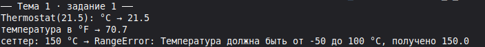

### Задание 2

**Счетчик шагов с защитой от скручивания:** Разработайте класс `Pedometer`, где текущие шаги можно только увеличивать через метод `addSteps(int count)`, а уменьшать нельзя.

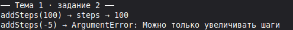

### Задание 3

**Модель книги с расчетом времени чтения:** Класс `Book` содержит поля названия и числа страниц. Добавьте вычисляемый геттер `estimatedReadingHours`, считающий время из расчета 1 страница в 2 минуты.

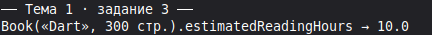

### Задание 4

**Валидатор пароля в сеттере:** Класс `UserCredentials` с приватным паролем `_passwordHash`. Сеттер принимает сырую строку, проверяет ее длину (\(\ge 8\) символов) и сохраняет псевдо-хэш.

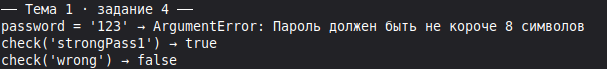

### Задание 5

**Статический счетчик экземпляров:** Добавьте в класс `DeviceSession` статическое поле `static int activeSessionsCount`, которое увеличивается при создании каждого нового объекта.

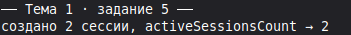

## Тема 2. Все виды конструкторов: Named, Initializer List, Factory, Const

### Задание 1

**Именованные конструкторы цвета:** Создайте класс `AppColor` с конструкторами `AppColor.fromHex(String hex)` и `AppColor.fromRGBO(int r, int g, int b, double o)`.

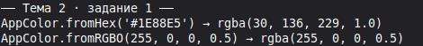

### Задание 2

**Константная точка на плоскости:** Создайте класс `const Point2D(this.x, this.y)`. Создайте два идентичных константных объекта и убедитесь, что `identical(p1, p2) == true`.

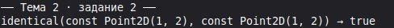

### Задание 3

**Список инициализации с assert:** Создайте класс `Rectangle` с полями ширины и высоты. В списке инициализации добавьте проверку `assert(width > 0 && height > 0)`.

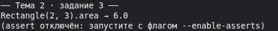

### Задание 4

**Фабричный синглтон сетевого клиента:** Реализуйте класс `ApiClient` с фабричным конструктором `factory ApiClient()`, гарантированно возвращающим один и тот же приватный экземпляр.

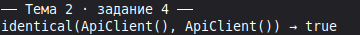

### Задание 5

**Редирект конструктора (Redirecting constructor):** Напишите класс `Circle(this.radius)` и именованный конструктор `Circle.unit() : this(1.0);`, перенаправляющий вызов на основной.

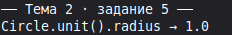

## Тема 3. Наследование (extends), полиморфизм и super

### Задание 1

**Иерархия банковских карт:** Создайте базовый класс `Card` и наследников `DebitCard` (без овердрафта) и `CreditCard` (с лимитом овердрафта).

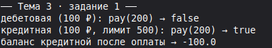

### Задание 2

**Полиморфный список виджетов:** Создайте список `List<BaseScreen>` и в цикле вызовите метод `render()` для каждого элемента независимо от конкретного подтипа.

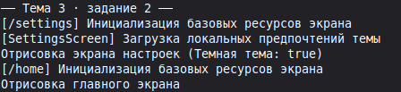

### Задание 3

**Использование super-параметров (Dart 2.17+):** Перепишите конструктор наследника с использованием компактного синтаксиса `SubClass({required super.id, super.title});`.

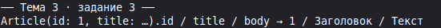

### Задание 4

**Ковариантный параметр метода (`covariant`):** Покажите пример сужения типа аргумента в переопределенном методе подкласса с помощью ключевого слова `covariant`.

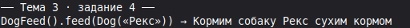

### Задание 5

**Предотвращение переопределения через `@nonVirtual`:** Создайте метод критической проверки лицензии в базовом классе и запретите его изменение в наследниках.

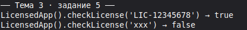

## Тема 4. Абстрактные классы, неявные интерфейсы (implements) и Sealed-классы

### Задание 1

**Контракт локального кэша:** Объявите интерфейс `StorageService` с методами `save(String key, String val)`, `read(String key)`, `delete(String key)`. Реализуйте класс `MemoryStorageService` через `implements`.

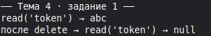

### Задание 2

**Множественная реализация интерфейсов:** Создайте класс `SmartTv`, реализующий сразу два несвязанных интерфейса: `Displayable` и `NetworkConnectable`.

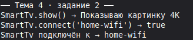

### Задание 3

**Sealed-иерархия авторизации:** Создайте `sealed class AuthState` с наследниками `Unauthenticated`, `Authenticating`, `Authenticated(User user)` и `AuthFailed(String reason)`.

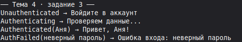

### Задание 4

**Модификатор `base class`:** Создайте класс `base class Engine`, гарантирующий, что сторонние библиотеки смогут только наследовать его (`extends`), но не смогут реализовать его как чистый интерфейс (`implements`).

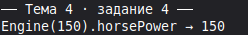

### Задание 5

**Модификатор `interface class`:** Создайте чистый интерфейсный контракт, исключающий прямое наследование реализации вне родной библиотеки.

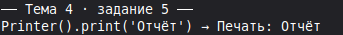

## Тема 5. Миксины (Mixins): композиция поведения через with и on

### Задание 1

**Миксин сериализации в JSON:** Создайте миксин `JsonPrintable`, добавляющий любому классу метод `printAsJson()`.

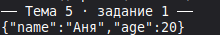

### Задание 2

**Ограничение миксина на ChangeNotifier:** Создайте миксин `AutoDisposer on ChangeNotifier`, добавляющий флаг `bool isDisposed` и проверяющий его в методах.

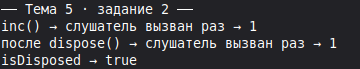

### Задание 3

**Аналитический трекер кликов:** Напишите миксин `AnalyticsTracker` с методом `trackEvent(String eventName)` и примените его к классу кнопки `CustomButton`.

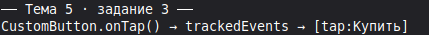

### Задание 4

**Порядок линеаризации миксинов:** Создайте класс с двумя миксинами, реализующими одинаковый метод `execute()`. Покажите на практике, метод какого миксина выполнится первым (принцип правого приоритета).

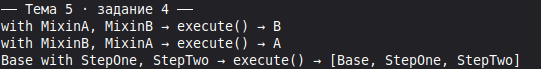

### Задание 5

**Миксин кэширования вычислений:** Создайте миксин `MemoizationMixin`, сохраняющий результаты тяжелых математических функций в словарь по строковому ключу аргументов.

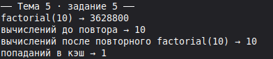

## 50 Смешанных заданий по ООП

### Блок 1: Модели данных, DTO и конструкторы

#### Задание 1

**Неизменяемая карточка товара (Immutable Product):** Создайте константную модель товара с обязательными полями, расчетом цены со скидкой и валидацией неотрицательной стоимости в списке инициализации.

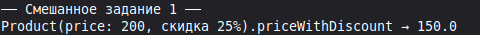

#### Задание 2

**Парсер профиля пользователя с безопасными дефолтами:** Реализуйте конструктор `User.fromJson(Map<String, dynamic> json)` с обработкой отсутствующих полей и защитой от `TypeError`.

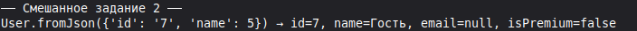

#### Задание 3

**Multiton локалей приложения:** Спроектируйте класс `AppLocale` с фабричным конструктором, возвращающим единственный экземпляр для каждого языка: `AppLocale("ru")`, `AppLocale("en")`.

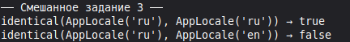

#### Задание 4

**Модель геоточки с парсингом строки:** Класс `GeoPoint` с именованным конструктором `GeoPoint.fromString("55.751244, 37.618423")`.

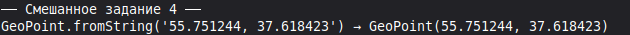

#### Задание 5

**Конструктор визитки из сущности БД:** Напишите фабричный конструктор `ContactCard.fromDatabaseRecord(Map<String, Object?> row)`.

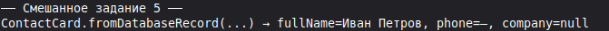

#### Задание 6

**Клонирование с изменением полей (copyWith):** Добавьте метод `UserModel copyWith({String? name, String? avatarUrl})` для неизменяемой модели.

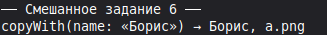

#### Задание 7

**Конструктор диапазона дат:** Класс `DateRange(this.start, this.end)` со списком инициализации, выбрасывающим `AssertionError`, если дата окончания раньше даты начала.

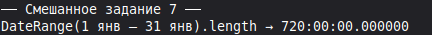

#### Задание 8

**DTO банковской транзакции:** Класс `TransactionDto` с именованными конструкторами для пополнения (`TransactionDto.deposit`), списания (`TransactionDto.withdrawal`) и перевода (`TransactionDto.transfer`).

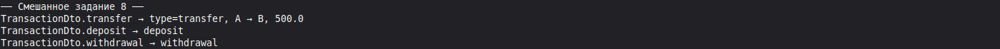

#### Задание 9

**Парсер конфигурации окружения (Environment):** Фабричный конструктор `EnvConfig.fromEnvironment()`, читающий флаги через `const String.fromEnvironment()`.

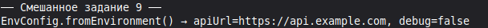

#### Задание 10

**Кастомный оператор эквивалентности:** Переопределите оператор `==` и метод `hashCode` для класса `CartItem` на основе совпадения полей `productId` и `selectedSize`.

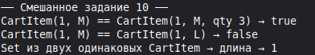

### Блок 2: Наследование и иерархия UI-компонентов

#### Задание 11

**Иерархия системных уведомлений:** Базовый класс `InAppNotification` (таймаут, заголовок) и наследники `SuccessNotification`, `WarningNotification`, `CriticalAlertNotification` с разным цветом и иконкой.

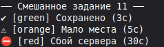

#### Задание 12

**Компоненты диалоговых окон:** Базовый класс `BaseDialog` с шаблоном отрисовки шапки и подвала, и наследник `ConfirmActionDialog` с кнопками «Подтвердить» и «Отмена».

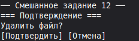

#### Задание 13

**Иерархия медиаплееров:** Базовый класс `MediaPlayer` (методы `play()`, `pause()`, `seek()`) и специализированные наследники `AudioPlayer` и `HlsVideoPlayer`.

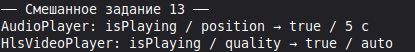

#### Задание 14

**Модели сенсоров смартфона:** Базовый класс `HardwareSensor` и подклассы `AccelerometerSensor` (оси X, Y, Z) и `BarometerSensor` (давление в гПа).

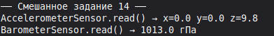

#### Задание 15

**Система тарифов подписки:** Базовый класс `SubscriptionPlan` и наследники `MonthlyPlan`, `AnnualDiscountPlan` (скидка 20%) и `FamilyPlan` (множитель цены за участников).

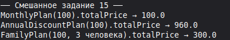

#### Задание 16

**Слои графического редактора:** Базовый класс `CanvasLayer` (прозрачность, видимость, z-index) и подклассы `VectorLayer`, `RasterBitmapLayer`, `TextLayer`.

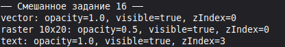

#### Задание 17

**Иерархия платежных шлюзов:** Базовый класс `PaymentGateway` с защищенным методом логирования и наследники `SbpGateway` (Система быстрых платежей) и `BankCardGateway`.

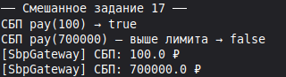

#### Задание 18

**Экраны онбординга:** Базовый экран обучающего тура с кнопкой пропуска и конкретные шаги с уникальными иллюстрациями.

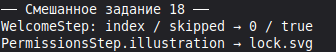

#### Задание 19

**Кастомная кнопка с состояниями:** Базовый класс `WidgetButton` и подкласс `AsyncLoadingButton`, отображающий индикатор загрузки при активном асинхронном действии.

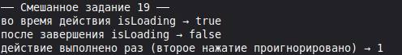

#### Задание 20

**Иерархия логгеров приложения:** Базовый класс `AppLogger` и подклассы `ConsoleLogger` (форматированный вывод в терминал) и `FileCrashLogger` (запись на диск).

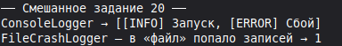

### Блок 3: Абстрактные контракты, интерфейсы и репозитории

#### Задание 21

**Репозиторий каталога товаров (Repository Pattern):** Объявите интерфейс `ProductRepository` с методами `Future<List<Product>> getAll()`, `Future<Product> getById(int id)` и создайте две реализации: `NetworkProductRepository` и `MockProductRepository`.

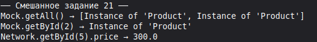

#### Задание 22

**Интерфейс биометрической аутентификации:** Спроектируйте интерфейс `BiometricAuthService` с методами `canAuthenticate()` и `authenticate()`. Напишите реализацию-заглушку для тестов.

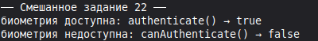

#### Задание 23

**Шифрование пользовательских данных:** Интерфейс `CryptoService` с методами `encrypt(String plainText)` и `decrypt(String cipherText)`. Реализуйте класс `AesCryptoService`.

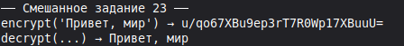

#### Задание 24

**Контракт аналитического провайдера:** Интерфейс `AnalyticsProvider` с методом `logEvent(String name, Map<String, Object> params)`. Реализуйте множественную отправку через класс `CompositeAnalyticsProvider`.

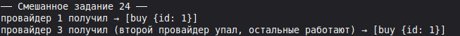

#### Задание 25

**Интерфейс геолокатора:** Спроектируйте контракт получения координат устройства с поддержкой стрима обновлений позиции `Stream<GeoPoint> get positionStream`.

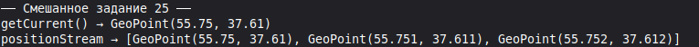

#### Задание 26

**Служба локальных уведомлений:** Интерфейс `NotificationSender` с методами отправки мгновенных и отложенных системных пушей.

#### Задание 27

**Контракт синхронизатора баз данных:** Абстрактный класс `DataSyncEngine` с абстрактными методами `fetchRemoteDelta()` и `applyLocalChanges()`.

#### Задание 28

**Провайдер сетевого статуса:** Интерфейс `ConnectivityService` с геттером `bool isOnline` и стримом событий потери интернета.

#### Задание 29

**Хранилище ключ-значение (KeyValueStorage):** Спроектируйте интерфейс с обобщенными методами `T? read<T>(String key)` и `Future<void> write<T>(String key, T value)`.

#### Задание 30

**Интерфейс экспортера отчетов:** Контракт `ReportExporter` с реализациями `PdfReportExporter` и `ExcelReportExporter`.

### Блок 4: Миксины и повторное использование функционала

#### Задание 31

**Миксин дебаунса событий (Anti-Spam Click):** Миксин `DebounceMixin`, предотвращающий повторный вызов одного и того же действия чаще чем раз в 500 мс.

#### Задание 32

**Миксин восстановления состояния экрана (RestorationMixin):** Миксин, автоматически сохраняющий текстовые поля ввода при сворачивании приложения.

#### Задание 33

**Миксин проверки сетевого соединения:** Миксин `NetworkAwareMixin`, внедряющий в презентер экрана проверку доступности интернета перед выполнением любого запроса.

#### Задание 34

**Миксин форматирования цен и валют:** Миксин `CurrencyFormatterMixin`, предоставляющий готовый метод преобразования чисел в красивый денежный формат.

#### Задание 35

**Миксин таймера автообновления:** Миксин `PeriodicRefreshMixin`, запускающий периодический опрос сервера каждые 30 секунд при активном экране.

#### Задание 36

**Миксин валидации паспортных данных:** Миксин `PassportValidationMixin` с методами строгой проверки серии, номера и кода подразделения.

#### Задание 37

**Миксин анимации затухания (FadeAnimationController):** Подмешиваемый контроллер управления прозрачностью элемента от 0.0 до 1.0.

#### Задание 38

**Миксин переключения темы:** Миксин, предоставляющий экрану быстрый доступ к текущей цветовой палитре (темная/светлая).

#### Задание 39

**Миксин глубоких ссылок (DeepLinkHandlerMixin):** Миксин, парсящий входящие URI-схемы приложения и открывающий целевые экраны.

#### Задание 40

**Миксин аудита действий администратора:** Подмешиваемый модуль, отправляющий критические действия модератора на выделенный сервер безопасности.

### Блок 5: Современные модификаторы классов и архитектурные стейты

#### Задание 41

**Sealed-состояние корзины интернет-магазина:** Создайте `sealed class CartState` с состояниями: `CartEmpty`, `CartLoading`, `CartLoaded(List<Item> items, double total)`, `CartCheckoutError(String error)`. Напишите функцию обработки состояний через исчерпывающий `switch`.

#### Задание 42

**Sealed-иерархия сетевого ответа (Result Pattern):** Реализуйте `sealed class Result<T>` с подтипами `Success<T>(final T data)` и `Failure<T>(final Exception exception)`.

#### Задание 43

**Архитектура UI-событий экрана логина:** Создайте `sealed class LoginEvent` с событиями `LoginEmailChanged(String email)`, `LoginPasswordChanged(String pass)`, `LoginSubmitted`.

#### Задание 44

**Модификатор `final class` для безопасности криптоключа:** Объявите класс `final class EncryptionKey`, запретив любое его расширение или реализацию вне текущей библиотеки.

#### Задание 45

**Модификатор `interface class` для публичного API SDK:** Разработайте интерфейсный класс платежного терминала, запретив прямое наследование логики клиентами библиотеки.

#### Задание 46

**Исчерпывающий роутинг экрана через Sealed Route:** Спроектируйте `sealed class AppRoute` для типобезопасной навигации во Flutter.

#### Задание 47

**Паттерн «Команда» (Command Pattern):** Создайте абстрактный класс `Command` с методом `execute()` и `undo()` для реализации функции отмены действий в редакторе текста.

#### Задание 48

**Паттерн «Строитель» (Builder):** Реализуйте `NotificationBuilder` с цепочечными вызовами `.setTitle().setBody().setIcon().build()`.

#### Задание 49

**Паттерн «Наблюдатель» (Observer / EventBus):** Создайте легковесную шину событий с классами событий и методами подписки/отписки.

#### Задание 50

**Комплексный архитектурный модуль заказа такси (Production Case):**

- Спроектируйте `sealed class TaxiOrderState` (поиск машины, машина назначена, поездка, завершено, отменено).
- Создайте класс заказа `TaxiOrder` с именованными фабричными конструкторами и списком инициализации.
- Реализуйте миксины `LocationTrackingMixin` и `FareCalculationMixin`.
- Напишите контроллер управления поездкой с исчерпывающим сопоставлением с шаблонами.

