# Практическая работа #9: Асинхронное программирование в Dart

## Тема 1. Отложенные вычисления: Future API и синтаксис async/await

### Задание 1

**Симулятор авторизации:** Напишите функцию `Future<bool> login(String user, String pass)`, которая через 1.5 секунды возвращает `true`, если пароль равен `"1234"`, и выбрасывает `AuthException` в противном случае.

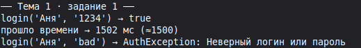

### Задание 2

**Параллельное чтение файлов конфигурации:** Запустите параллельно три вызова `Future` с разным временем задержки с помощью `Future.wait()` и объедините их результаты в одну карту.

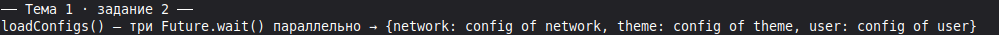

### Задание 3

**Гонка асинхронных задач (Future.any):** Запустите запрос к двум зеркалам одного сервера (задержка 800 мс и 1200 мс) и получите ответ от самого быстрого с помощью `Future.any()`.

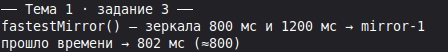

### Задание 4

**Повторные попытки с задержкой (Retry Pattern):** Напишите функцию `retry(Future Function() task, int maxAttempts)`, которая при падении задачи повторяет вызов до 3 раз с паузой в 1 секунду.

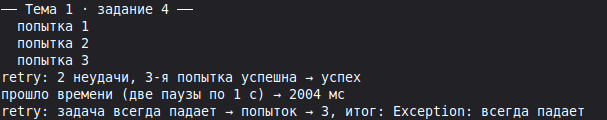

### Задание 5

**Цепочка промисов через then/catchError:** Реализуйте аналогичную логику авторизации без использования ключевых слов `async/await`, используя только методы `.then()`, `.catchError()` и `.whenComplete()`.

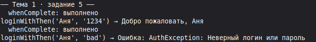

## Тема 2. Непрерывные потоки: Stream API и генераторы async\*

### Задание 1

**Поток тиков секундомера:** Создайте функцию `Stream<int> stopWatch() async*`, непрерывно генерирующую инкрементный счетчик каждую секунду.

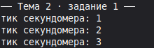

### Задание 2

**Поток GPS-координат (Имитация):** Сгенерируйте поток кортежей `(double lat, double lon)`, слегка изменяющих координаты каждые 500 мс.

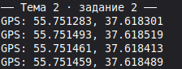

### Задание 3

**Широковещательный стрим котировок:** Создайте однократный поток цен, преобразуйте его в Broadcast через `.asBroadcastStream()` и подключите двух разных слушателей: UI-виджет и логгер аналитики.

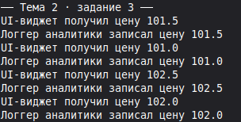

### Задание 4

**Агрегация потока (fold/reduce):** Посчитайте сумму чисел, поступающих из потока из 10 элементов, с помощью метода `stream.fold()`.

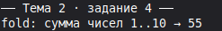

### Задание 5

**Делегирование генератора через yield\*:** Напишите функцию, которая объединяет два потока последовательно с помощью синтаксиса `yield* subStream`.

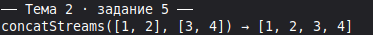

## Тема 3. Реактивное управление: StreamController и StreamTransformer

### Задание 1

**Кастомный StreamTransformer:** Реализуйте трансформер строк через `StreamTransformer.fromHandlers()`, переводящий все входящие сообщения в верхний регистр.

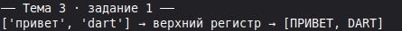

### Задание 2

**Контроллер поискового ввода:** Реализуйте класс `SearchControllerWrapper`, принимающий посимвольный ввод пользователя в Sink и отдающий очищенную строку в Stream.

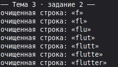

### Задание 3

**Обработка ошибок в контроллере:** Отправьте ошибку в контроллер с помощью `sink.addError(Exception("Сбой датчика"))` и перехватите её в секции `onError` слушателя.

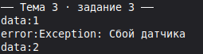

### Задание 4

**Контроль состояния закрытия:** Напишите метод, проверяющий свойство `controller.isClosed` перед попыткой добавить новое событие, предотвращая падение с ошибкой.

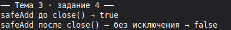

### Задание 5

**Счетчик активных подписчиков:** Сконфигурируйте `StreamController(onListen: ..., onCancel: ...)` для отслеживания момента появления и ухода подписчиков.

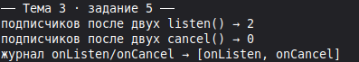

## Тема 4. Истинная многопоточность: Изоляты (Isolates) и Isolate.run

### Задание 1

**Параллельный парсер JSON:** Напишите функцию, принимающую строку из 10 000 фиктивных записей и десериализующую ее в объекты через `Isolate.run()`.

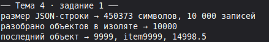

### Задание 2

**Поиск простых чисел в фоне:** Запустите вычисление всех простых чисел до 1 000 000 в фоновом изоляте, параллельно выводя в консоль главного потока точки каждую секунду.

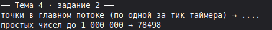

### Задание 3

**Двусторонний обмен через порты:** Создайте изолят-калькулятор, который слушает команды по `SendPort`, выполняет операции сложения и отправляет ответ обратно.

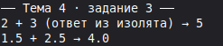

### Задание 4

**Замер падения FPS:** Напишите скрипт, запускающий цикл на 2 млрд итераций сначала синхронно в `main()`, а затем в `Isolate.run()`, сравнив отзывчивость таймеров.

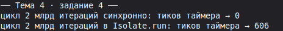

### Задание 5

**Принудительное уничтожение изолята:** Запустите бесконечный фоновый изолят через `Isolate.spawn` и принудительно завершите его работу методом `isolate.kill(priority: Isolate.immediate)`.

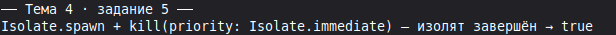

## 50 Смешанных заданий по асинхронной разработке

### Блок 1: Сетевые запросы, таймеры и Future

#### Задание 1

**Имитатор HTTP GET запроса:** Напишите функцию `fetchData(String url)`, возвращающую JSON через 1200 мс с обработкой статусов 200, 404 и 500.

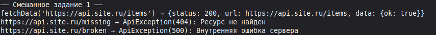

#### Задание 2

**Экспоненциальная задержка (Exponential Backoff):** Реализуйте повтор сетевого запроса с прогрессирующей паузой: 1с, 2с, 4с, 8с при возникновении `SocketException`.

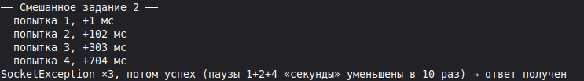

#### Задание 3

**Параллельная загрузка медиафайлов:** Скачайте метаданные для 5 картинок одновременно через `Future.wait()`, ограничив параллелизм до 2 одновременных вызовов.

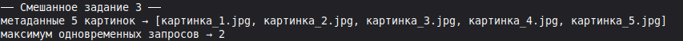

#### Задание 4

**Валидатор доступности сервера (Ping):** Отправьте пинг-запросы к трем зеркалам и верните URL первого ответившего сервера (`Future.any`).

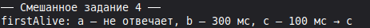

#### Задание 5

**Прерываемый запрос по таймауту:** Оберните вызов длительного сохранения профиля в таймаут 3 секунды с аварийным прерыванием операции.

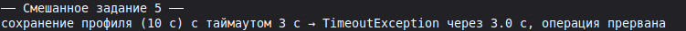

#### Задание 6

**Очередь последовательного выполнения (Async Queue):** Спроектируйте класс, выполняющий поступающие асинхронные задачи строго по очереди друг за другом (FIFO).

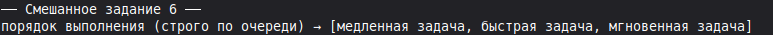

#### Задание 7

**Асинхронный замер времени выполнения:** Напишите утилиту `benchmark(Future Function() task)`, замеряющую точное время выполнения асинхронного блока в миллисекундах (`Stopwatch`).

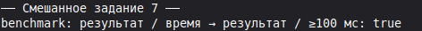

#### Задание 8

**Ленивый асинхронный синглтон:** Реализуйте инициализацию конфигурации приложения `AppConfig.getInstance()`, выполняющую чтение данных из асинхронного источника ровно один раз.

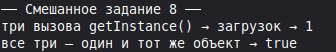

#### Задание 9

**Параллельное слияние локального и сетевого кэша:** Запустите чтение локальной базы SQLite и сетевой вызов одновременно, вернув локальные данные, если сеть не успела ответить за 300 мс.

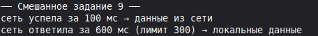

#### Задание 10

**Асинхронный дебаунсер (Debounce):** Напишите функцию, откладывающую выполнение сетевого поиска на 400 мс и сбрасывающую таймер при каждом новом нажатии клавиши.

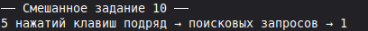

### Блок 2: Потоковые данные, датчики и Stream API

#### Задание 11

**Слушатель котировок криптовалют:** Смоделируйте WebSocket-поток, передающий случайную цену биткоина раз в 200 мс, и отфильтруйте всплески более 5%.

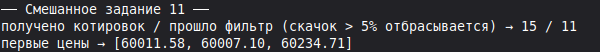

#### Задание 12

**Стриминг прогресса скачивания файла:** Напишите асинхронный генератор `async*`, передающий процент загрузки от 0% до 100% с шагом в 10% каждые 300 мс.

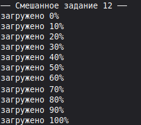

#### Задание 13

**Объединение двух потоков (Merge):** Создайте функцию, объединяющую события из потока геолокации и потока компаса в единый поток навигации.

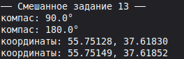

#### Задание 14

**Дросселирование потока (Throttle):** Реализуйте оператор, пропускающий не более одного клика по кнопке в секунду из непрерывного потока нажатий.

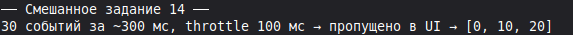

#### Задание 15

**Поток шагов акселерометра:** Сгенерируйте поток показаний ускорения по трем осям, подсчитывающий число шагов при превышении порогового значения.

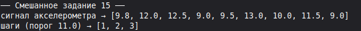

#### Задание 16

**Автоматическое переподключение потока (Reconnection):** Напишите слушатель стрима чата, который при возникновении ошибки автоматически пересоздает подписку через 2 секунды.

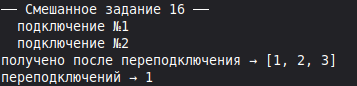

#### Задание 17

**Буферизация потока пачками (Buffer / Chunk):** Накапливайте события кликов в список и отдавайте их пачками по 5 штук или раз в 3 секунды.

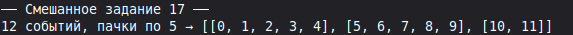

#### Задание 18

**Поток обратного отсчета для OTP-кода:** Создайте стрим таймера на 60 секунд для экрана ввода SMS с уведомлением о завершении срока жизни кода.

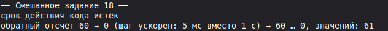

#### Задание 19

**Потоковый калькулятор скользящего среднего:** Спроектируйте стрим, принимающий числа и отдающий скользящее среднее значение последних 5 измерений.

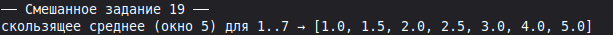

#### Задание 20

**Преобразование Stream в Future:** Извлеките последнее значение из конечного потока с помощью метода `stream.last`.

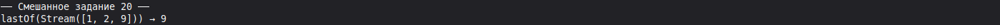

### Блок 3: Реактивные шины событий и StreamController

#### Задание 21

**Шина глобальных событий (EventBus):** Создайте синглтон `EventBus` на базе широковещательного `StreamController` для обмена событиями между несвязанными экранами.

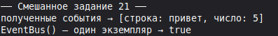

#### Задание 22

**Реактивная корзина интернет-магазина:** Реализуйте класс `CartStore`, транслирующий в стрим текущее количество товаров и итоговую сумму при вызовах `add()` и `remove()`.

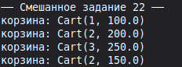

#### Задание 23

**Счетчик непрочитанных сообщений:** Спроектируйте контроллер бейджа уведомлений, увеличивающий счетчик при новых событиях и сбрасывающий его в ноль при прочтении.

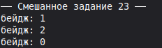

#### Задание 24

**Управление состоянием аудиоплеера:** Реализуйте `AudioPlayerBloc` со стримом состояний: `PlayerStopped`, `PlayerPlaying(track)`, `PlayerPaused`.

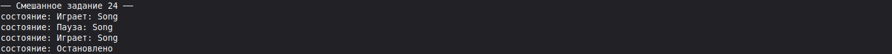

#### Задание 25

**Контроллер бесконечной ленты (Pagination Stream):** Спроектируйте стрим, подгружающий следующую страницу новостей при передаче события `LoadNextPage`.

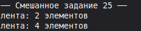

#### Задание 26

**Реактивный переключатель темной темы:** Создайте менеджер темы приложения, отдающий `ThemeMode.dark` или `ThemeMode.light` через `BehaviorSubject`-подобный контроллер.

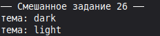

#### Задание 27

**Слушатель сетевого статуса (Connectivity Stream):** Контроллер, транслирующий изменения подключения (`WiFi`, `Cellular`, `None`) во все подписанные модули.

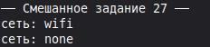

#### Задание 28

**Защита контроллера от утечек памяти (Auto-Dispose):** Напишите класс с механизмом проверки наличия подписчиков и автоматическим вызовом `close()` при обнулении слушателей.

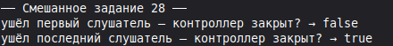

#### Задание 29

**Валидация формы регистрации на стримах:** Создайте два потока для полей Email и Пароль, объедините их через `Rx.combineLatest`-подобную логику и отдавайте флаг активности кнопки `isSubmitEnabled`.

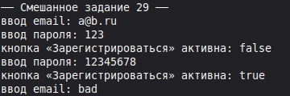

#### Задание 30

**Потоковый логгер крашей:** Направляйте все неотловленные ошибки приложения через `StreamController` в фоновый модуль отправки аналитики.

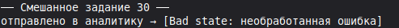

### Блок 4: Изоляты и ресурсоемкие параллельные задачи

#### Задание 31

**Фоновая генерация миниатюр (Thumbnail Generator):** Обработайте массив байтов изображения в `Isolate.run()`, изменив его размер и вернув сжатый массив.

#### Задание 32

**Шифрование базы заметок:** Выполните шифрование большого текстового файла по алгоритму XOR / AES в параллельном изоляте без просадки FPS.

#### Задание 33

**Полнотекстовый поиск по 100 000 документов:** Передайте поисковый запрос и список документов в фоновый изолят, вернув 10 наиболее релевантных совпадений.

#### Задание 34

**Парсинг тяжелого GeoJSON карты города:** Распарсите координаты полигонов районов города в фоновом потоке памяти и верните готовые структуры данных.

#### Задание 35

**Сжатие логов в ZIP-архив:** Смоделируйте упаковку текстовых журналов в сжатый архив через изолят перед отправкой в техподдержку.

#### Задание 36

**Двусторонний пул воркеров (Worker Pool):** Создайте менеджер из двух постоянно работающих изолятов, распределяющий между ними математические задачи.

#### Задание 37

**Генерация PDF-отчета:** Сформируйте текстовую структуру финансового отчета за год в параллельном изоляте.

#### Задание 38

**Сортировка массива из 1 000 000 чисел:** Сравните время сортировки массива в главном потоке и в отдельном изоляте.

#### Задание 39

**Конвертер аудио-семплов:** Смоделируйте преобразование массива сырых аудио-семплов в изоляте.

#### Задание 40

**Безопасная передача больших объектов (TransferableTypedData):** Передайте большой бинарный буфер между изолятами без затратного копирования памяти.

### Блок 5: Сложные асинхронные архитектуры и отказоустойчивость

#### Задание 41

**Отмена сетевой операции через CancelToken:** Реализуйте класс токена отмены, выбрасывающий `CancellationException` при прерывании пользователем ухода со страницы.

#### Задание 42

**Репликация базы данных с разрешением конфликтов:** Синхронизируйте две асинхронные очереди изменений с временными метками (Timestamps).

#### Задание 43

**Асинхронная очередь сохранения офлайн-заказов:** Сохраняйте оформленные без интернета заказы в локальную очередь и автоматически отправляйте их по одному при восстановлении сети.

#### Задание 44

**Паттерн Circuit Breaker:** Реализуйте защиту от падения сервера: если 5 запросов подряд завершились ошибкой, переведите сервис в режим «Разрыв цепи» на 30 секунд.

#### Задание 45

**Асинхронный семафор (Rate Limiter):** Ограничьте число одновременных сетевых обращений к API до 3 параллельных потоков.

#### Задание 46

**Гонка состояний при быстром вводе (Race Condition Fix):** Защитите поисковую строку: гарантируйте, что старый медленный ответ сервера не перезапишет новый быстрый ответ.

#### Задание 47

**Слушатель жизненного цикла приложения:** Свяжите события сворачивания приложения с мгновенной приостановкой всех активных `StreamSubscription`.

#### Задание 48

**Конечный автомат асинхронной синхронизации:** Реализуйте переключение стейтов `Idle` -> `Syncing(progress)` -> `Success` -> `Error` с защитой от повторного запуска во время синхронизации.

#### Задание 49

**Многоуровневый кэш (Memory -> Disk -> Network):** Спроектируйте функцию, последовательно проверяющую быструю оперативную память, затем локальный диск и только потом идущую в сеть.

#### Задание 50

**Итоговый реактивный модуль финансового терминала (Production Architecture):**

- Подключите непрерывный поток биржевых котировок через WebSocket-имитатор.
- Передайте расчет скользящей волатильности в параллельный изолят (`Isolate.run`).
- Ограничьте частоту обновления графического экрана до 60 кадров/сек с помощью троттлинга.
- Реализуйте автоматическое восстановление соединения при обрыве и безопасный вызов `dispose()` для всех контроллеров и подписок.

