# Практическая работа: скриншоты и логи по 80 заданиям

У каждого задания слева экран приложения, справа шторка уведомлений. Под картинкой строки Logcat с тегом `A80_`.

## 1. Тема 1, задание 1

1. **Служба таймера обратного отсчета:** Создайте Started Service, который считает секунды от 60 до 0 в фоновом потоке и логирует значение в Logcat.


```
17:54:09.450 I/A80_1   ( 7397): START
17:54:09.491 I/A80_1_1 ( 7397): seconds=60
17:54:10.491 I/A80_1_1 ( 7397): seconds=59
17:54:11.492 I/A80_1_1 ( 7397): seconds=58
17:54:12.492 I/A80_1_1 ( 7397): seconds=57
17:54:13.493 I/A80_1_1 ( 7397): seconds=56
17:54:14.493 I/A80_1_1 ( 7397): seconds=55
```

---

## 2. Тема 1, задание 2

2. **Foreground-сервис аудиоплеера:** Реализуйте Foreground Service с типом `mediaPlayback`, показывающий постоянное уведомление с названием играющей мелодии.

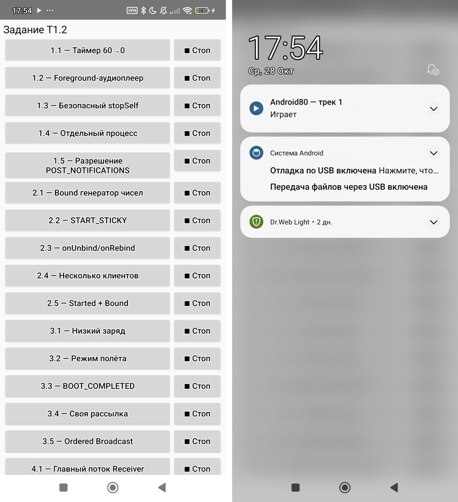

```
17:54:16.601 I/A80_2   ( 7510): START
17:54:16.923 I/A80_2   ( 7510): action=com.university.app.player.PLAY track=0
```

---

## 3. Тема 1, задание 3

3. **Безопасная остановка (stopSelf):** Доработайте службу скачивания файла так, чтобы после завершения цикла передачи байт она вызывала `stopSelf(startId)`, гарантируя, что не прервутся новые поступившие запросы.


```
17:54:23.661 I/A80_3   ( 7635): START
17:54:23.712 I/A80_1_3 ( 7635): bytes=4096
17:54:23.712 I/A80_1_3 ( 7635): bytes=8192
17:54:23.716 I/A80_1_3 ( 7635): bytes=12288
17:54:23.716 I/A80_1_3 ( 7635): bytes=16384
17:54:23.716 I/A80_1_3 ( 7635): bytes=20480
17:54:23.716 I/A80_1_3 ( 7635): bytes=24576
17:54:23.716 I/A80_1_3 ( 7635): bytes=28672
17:54:23.716 I/A80_1_3 ( 7635): bytes=32000
17:54:23.716 I/A80_1_3 ( 7635): stopSelf(1)
```

---

## 4. Тема 1, задание 4

4. **Служба с отдельным процессом:** Задекларируйте сервис в манифесте с атрибутом `android:process=":downloader"` и выведите имя процесса через метод `Process.myPid()`.


```
17:54:31.241 I/A80_4   ( 7786): START
17:54:31.527 I/A80_1_4 ( 7845): pid=7845 process=com.university.app:downloader
```

---

## 5. Тема 1, задание 5

5. **Проверка разрешений перед стартом:** Напишите метод в Activity, проверяющий наличие системного разрешения `POST_NOTIFICATIONS` перед вызовом `startForegroundService()`.
---


```
17:54:40.531 I/A80_5   ( 7927): START
```

---

## 6. Тема 2, задание 1

1. **Служба генерации случайных чисел (Bound):** Создайте привязанный сервис, предоставляющий метод `getRandomNumber()`. В Activity отображайте полученное число в `TextView`.


```
17:54:47.727 I/A80_6   ( 8050): START
17:54:47.772 I/A80_2_4 ( 8050): bind
17:54:47.803 I/A80_2_4 ( 8050): clients=1
17:54:47.804 I/A80_5   ( 8050): onBind result=4022
```

---

## 7. Тема 2, задание 2

2. **Эксперимент с START_STICKY:** Напишите службу со счетчиком секунд, принудительно «убейте» процесс через вкладку Logcat или команду `adb shell am kill` и зафиксируйте в логах перезапуск без интента.


```
17:54:54.590 I/A80_7   ( 8152): START
17:54:54.623 I/A80_2_2 ( 8152): intent null=false
17:54:54.652 I/A80_2_2 ( 8152): sec=0
17:54:55.652 I/A80_2_2 ( 8152): sec=1
17:54:56.654 I/A80_2_2 ( 8152): sec=2
17:54:57.655 I/A80_2_2 ( 8152): sec=3
17:54:58.698 I/A80_2_2 ( 8152): sec=4
17:54:59.699 I/A80_2_2 ( 8152): sec=5
```

---

## 8. Тема 2, задание 3

3. **Управление жизненным циклом через onUnbind:** Переопределите метод `boolean onUnbind(Intent intent)`. Настройте возвращаемое значение `true`, чтобы при повторном подключении клиентов вызывался `onRebind()`.


```
17:55:01.584 I/A80_8   ( 8241): START
17:55:01.620 I/A80_2_4 ( 8241): bind
17:55:01.652 I/A80_2_4 ( 8241): clients=1
17:55:01.653 I/A80_7   ( 8241): onBind result=6862
```

---

## 9. Тема 2, задание 4

4. **Слушатель множественных клиентов:** Реализуйте в Bound Service счетчик одновременно подключенных экранов (клиентов) и выводите их количество при каждом `bind/unbind`.

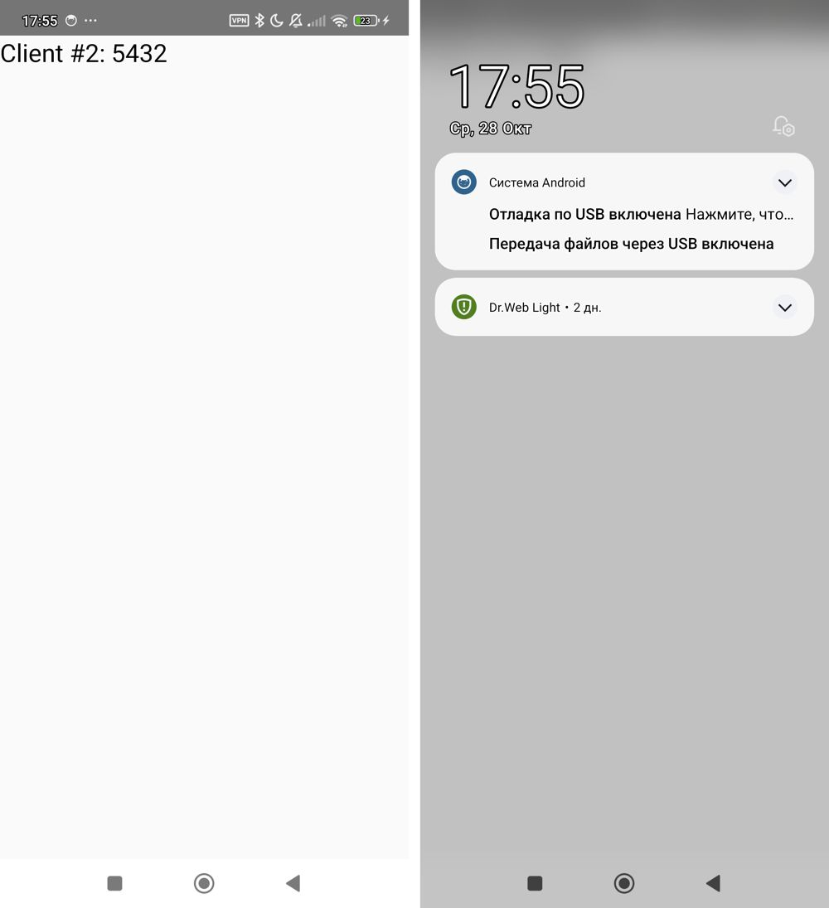

```
17:55:08.643 I/A80_9   ( 8347): START
17:55:08.719 I/A80_2_4 ( 8347): bind
17:55:08.766 I/A80_2_4 ( 8347): clients=1
17:55:08.767 I/A80_8   ( 8347): onBind result=9035
17:55:08.832 I/A80_2_4 ( 8347): clients=2
```

---

## 10. Тема 2, задание 5

5. **Комбинированный сервис (Started + Bound):** Создайте службу, которая сначала запускается через `startService()` (чтобы не умирать при выходе из экрана), а затем временно привязывается через `bindService()` для чтения статуса.
---


```
17:55:15.512 I/A80_10  ( 8453): START
17:55:15.559 I/A80_2_4 ( 8453): bind
17:55:15.594 I/A80_2_4 ( 8453): clients=1
17:55:15.595 I/A80_9   ( 8453): onBind result=4536
```

---

## 11. Тема 3, задание 1

1. **Приемник уровня заряда батареи:** Зарегистрируйте динамический приемник для системного действия `Intent.ACTION_BATTERY_LOW` и выведите предупреждение на экран.


```
17:55:22.480 I/A80_11  ( 8548): START
17:55:22.483 I/A80_11  ( 8548): registered android.intent.action.BATTERY_LOW
```

---

## 12. Тема 3, задание 2

2. **Перехват режима полета:** Напишите приемник события `Intent.ACTION_AIRPLANE_MODE_CHANGED` и считайте состояние переключателя.


```
17:55:29.693 I/A80_12  ( 8655): START
17:55:29.694 I/A80_12  ( 8655): registered android.intent.action.AIRPLANE_MODE
```

---

## 13. Тема 3, задание 3

3. **Статический приемник перезагрузки:** Настройте в манифесте ресивер с фильтром `BOOT_COMPLETED`, требующий разрешения `android.permission.RECEIVE_BOOT_COMPLETED`.


```
17:55:36.578 I/A80_13  ( 8796): START
17:55:36.607 I/A80_BOOT( 8796): boot=com.university.app.TEST_BOOT
17:55:36.707 I/A80_4_4 ( 8796): saved last_boot
17:55:36.712 I/A80_8   ( 8796): deleted=0
```

---

## 14. Тема 3, задание 4

4. **Кастомный внутрипрограммный бродкаст:** Отправьте кастомное широковещательное намерение `com.university.CUSTOM_ALERT` через `sendBroadcast()` и примите его во втором ресивере.


```
17:55:43.664 I/A80_14  ( 8968): START
17:55:43.702 I/A80_40  ( 8968): toggle receiver active
```

---

## 15. Тема 3, задание 5

5. **Упорядоченный бродкаст (Ordered Broadcast):** Напишите два приемника с разными приоритетами (`android:priority="100"` и `"200"`), продемонстрировав перехват и прерывание цепочки методом `abortBroadcast()`.
---


```
17:55:50.591 I/A80_15  ( 9223): START
17:55:50.593 I/A80_15  ( 9223): ordered sent
17:55:50.629 I/A80_3_5 ( 9223): priority 200
17:55:50.629 I/A80_3_5 ( 9223): ordered broadcast aborted at 200
```

---

## 16. Тема 4, задание 1

1. **Проверка главного потока:** Выведите идентификатор текущего потока в `onReceive()` через `Looper.myLooper() == Looper.getMainLooper()` и убедитесь, что код выполняется на UI-потоке.


```
17:55:57.613 I/A80_16  ( 9380): START
17:55:57.647 I/A80_4_1 ( 9380): UI thread=true
```

---

## 17. Тема 4, задание 2

2. **Имитация ошибки ANR:** Создайте в учебном проекте задержку `Thread.sleep(15000)` в `onReceive()` и зафиксируйте аварийное поведение системы в логах.


```
17:56:04.594 I/A80_17  ( 9503): START
17:56:18.736 I/A80_4_2 ( 9503): onReceive 15000ms BEGIN
```

---

## 18. Тема 4, задание 3

3. **Безопасная передача задачи в WorkManager:** Напишите в `onReceive()` постановку тяжелой фоновой задачи в очередь через `WorkManager.getInstance(context).enqueue(oneTimeWorkRequest)`.


```
17:56:24.618 I/A80_18  ( 9650): START
17:56:24.656 I/A80_4_3 ( 9650): onReceive: Worker поставлен в очередь, id=f5319088-77a5-49ca-aeb2-8d822954c1eb
17:56:24.747 I/A80_8   ( 9650): deleted=0
17:56:24.767 I/WM-WorkerWrapper( 9650): Worker result SUCCESS for Work [ id=f5319088-77a5-49ca-aeb2-8d822954c1eb, tags={ com.university.app.CleanupWorker,A80_Worker } ]
```

---

## 19. Тема 4, задание 4

4. **Асинхронная запись в SharedPreferences:** Используя механизм `goAsync()`, сохраните в локальные настройки время наступления системного события перезагрузки.

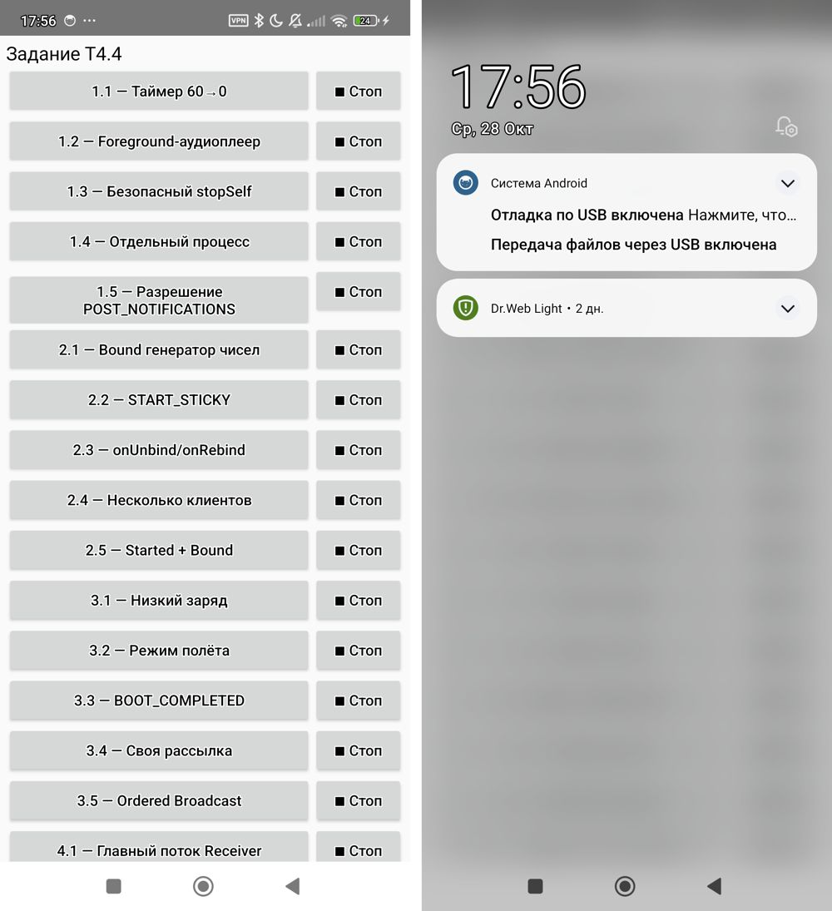

```
17:56:31.657 I/A80_19  ( 9761): START
17:56:31.706 I/A80_4_4 ( 9761): saved last_boot
```

---

## 20. Тема 4, задание 5

5. **Предотвращение утечки памяти:** Покажите на практике, почему отсутствие вызова `unregisterReceiver()` в методе `onDestroy()` или `onStop()` Activity приводит к утечке контекста окна.
---


```
17:56:38.657 I/A80_20  ( 9859): START
17:56:38.659 I/A80_20  ( 9859): registered android.intent.action.BATTERY_LOW
17:56:38.664 I/A80_20  ( 9859): unregistered
17:56:38.765 I/A80_4_5 ( 9859): ресивер зарегистрирован, unregisterReceiver() не вызывается, закрываем Activity
```

---

## 21. Тема 5, задание 1

1. **Чтение системных контактов:** С помощью `ContentResolver.query()` обратитесь к URI `ContactsContract.CommonDataKinds.Phone.CONTENT_URI` и выведите список имен в лог.


```
17:56:45.609 I/A80_21  (10009): START
... прочитано контактов: 21 (имена скрыты)
```

---

## 22. Тема 5, задание 2

2. **Медиатека изображений (MediaStore):** Напишите запрос через ContentResolver к `MediaStore.Images.Media.EXTERNAL_CONTENT_URI` для получения названий и размеров фото.


```
17:56:52.591 I/A80_22  (10095): START
17:56:52.904 I/A80_22  (10095): IMG-20220421-WA0000.jpg 56264
17:56:52.904 I/A80_22  (10095): IMG-20220421-WA0001.jpg 141185
17:56:52.904 I/A80_22  (10095): IMG-20220501-WA0000.jpg 208200
17:56:52.904 I/A80_22  (10095): IMG-20220501-WA0001.jpg 161307
17:56:52.904 I/A80_22  (10095): IMG-20220501-WA0002.jpg 171248
17:56:52.904 I/A80_22  (10095): IMG-20220501-WA0003.jpg 250734
17:56:52.904 I/A80_22  (10095): IMG-20220501-WA0004.jpg 190909
17:56:52.904 I/A80_22  (10095): IMG-20220501-WA0005.jpg 182609
17:56:52.904 I/A80_22  (10095): IMG-20220501-WA0006.jpg 211535
```

---

## 23. Тема 5, задание 3

3. **Реализация UriMatcher с маской строки:** Добавьте в `UriMatcher` поддержку строкового фильтра категорий с маской `*` (`notes/category/*`).

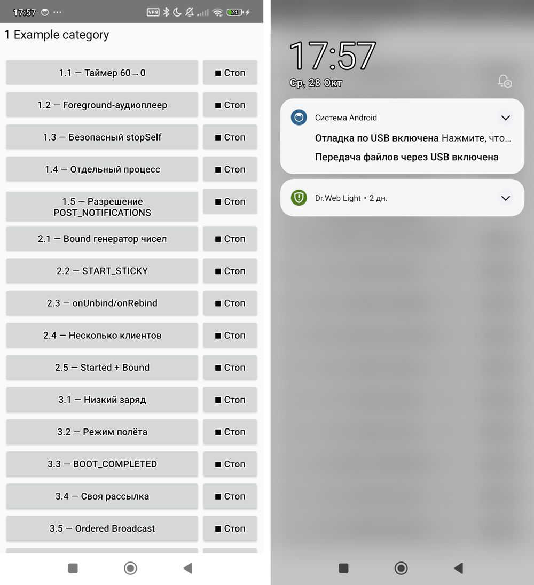

```
17:56:59.586 I/A80_23  (10194): START
17:56:59.607 I/A80_100 (10194): Insert content://com.university.app.notes/notes/1
```

---

## 24. Тема 5, задание 4

4. **Валидация входящих значений в insert:** Реализуйте в методе `insert()` проверку на наличие обязательного текстового поля и выбрасывайте `IllegalArgumentException` при его отсутствии.


```
17:57:06.545 I/A80_24  (10289): START
17:57:06.547 I/A80_24  (10289): validation rejected title required
```

---

## 25. Тема 5, задание 5

5. **Уведомление об изменениях данных:** Реализуйте регистрацию `ContentObserver` в Activity, чтобы экран автоматически обновлялся при вызове `notifyChange()` провайдером.
---

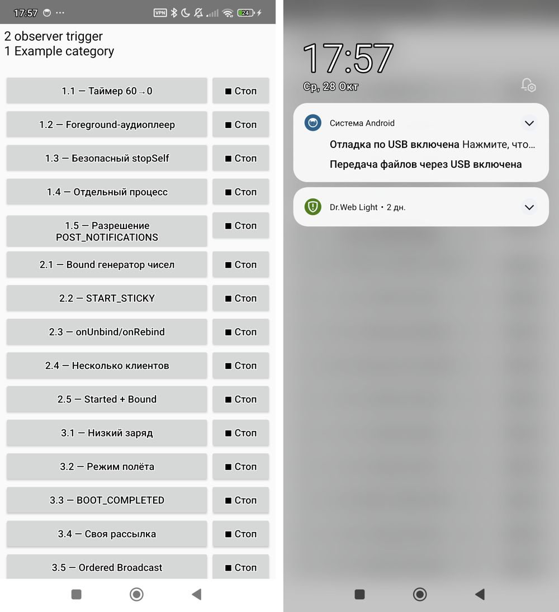

```
17:57:13.522 I/A80_25  (10386): START
17:57:13.534 I/A80_100 (10386): Insert content://com.university.app.notes/notes/2
17:57:13.565 I/A80_25  (10386): ContentObserver changed
```

---

## 26. Тема 6, задание 1

1. **Анализ порядка инициализации:** Поставьте контрольные логи в `Application.onCreate()`, `ContentProvider.onCreate()` и `MainActivity.onCreate()` и сравните их таймстемпы в Logcat.


```
17:57:19.471 I/A80_6_1 (10489): ContentProvider.onCreate time=124831651829826
17:57:19.550 I/A80_6_1 (10489): Application.onCreate time=124831730327639
17:57:19.584 I/A80_6_1 (10489): Activity.onCreate time=124831764288368
17:57:20.584 I/A80_26  (10489): START
17:57:20.584 I/A80_26  (10489): Порядок старта процесса смотри по строкам A80_6_1: Provider, Application, Activity
```

---

## 27. Тема 6, задание 2

2. **Синхронизация методов CRUD:** Оберните критические секции вставки в блок `synchronized` и объясните риски блокировки пула потоков Binder.


```
17:57:27.548 I/A80_27  (10607): START
17:57:27.557 I/A80_100 (10607): Insert content://com.university.app.notes/notes/3
17:57:27.557 I/A80_27  (10607): CRUD synchronized
```

---

## 28. Тема 6, задание 3

3. **Использование транзакций SQLite:** Напишите метод пакетной вставки `applyBatch()` с открытием транзакции через `db.beginTransaction()` и `db.setTransactionSuccessful()`.


```
17:57:34.535 I/A80_28  (10715): START
17:57:34.570 I/A80_28  (10715): applyBatch committed rows=10
17:57:34.572 I/A80_28  (10715): done
```

---

## 29. Тема 6, задание 4

4. **Настройка FileProvider:** Сконфигурируйте системный `androidx.core.content.FileProvider` с файлом путей `file_paths.xml` для безопасной выдачи URI локального PDF-файла.

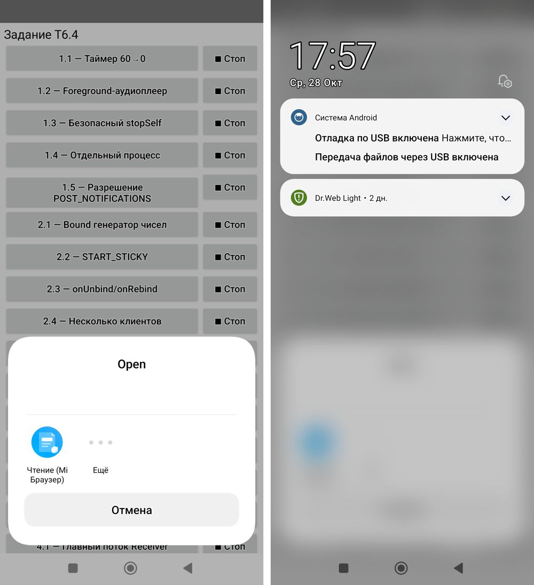

```
17:57:41.540 I/A80_29  (10812): START
17:57:41.578 I/A80_29  (10812): done
```

---

## 30. Тема 6, задание 5

5. **Защита провайдера от SQL-инъекций:** Продемонстрируйте подстановку параметров через аргументы `selectionArgs` вместо конкатенации сырых строк.
---


```
22:41:22.932 I/A80_30  (19083): START
22:41:22.943 I/A80_100 (19083): Insert content://com.university.app.notes/notes/1
```

---

## 31. Задание 1 из 50

1. **Фоновый шагомер (Step Tracker):** Разработайте сервис переднего плана, слушающий аппаратный датчик `TYPE_STEP_COUNTER` и обновляющий число шагов в уведомлении раз в 10 секунд.

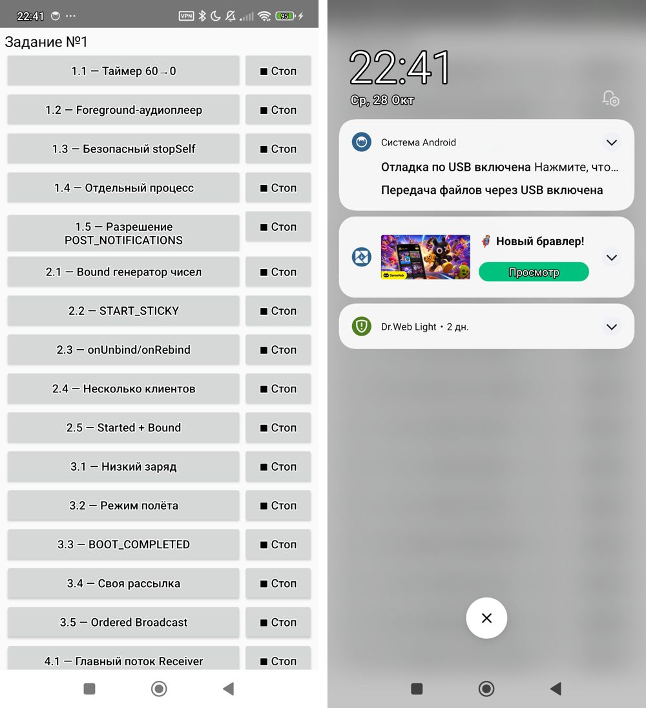

```
22:41:31.049 I/A80_31  (19178): START
22:41:31.321 I/A80_1   (19178): step_counter=0
```

---

## 32. Задание 2 из 50

2. **Аудиоплеер с управлением из шторки:** Реализуйте привязанный сервис с кнопками «Play», «Pause», «Next» в интерактивном уведомлении (`NotificationCompat.Action`).

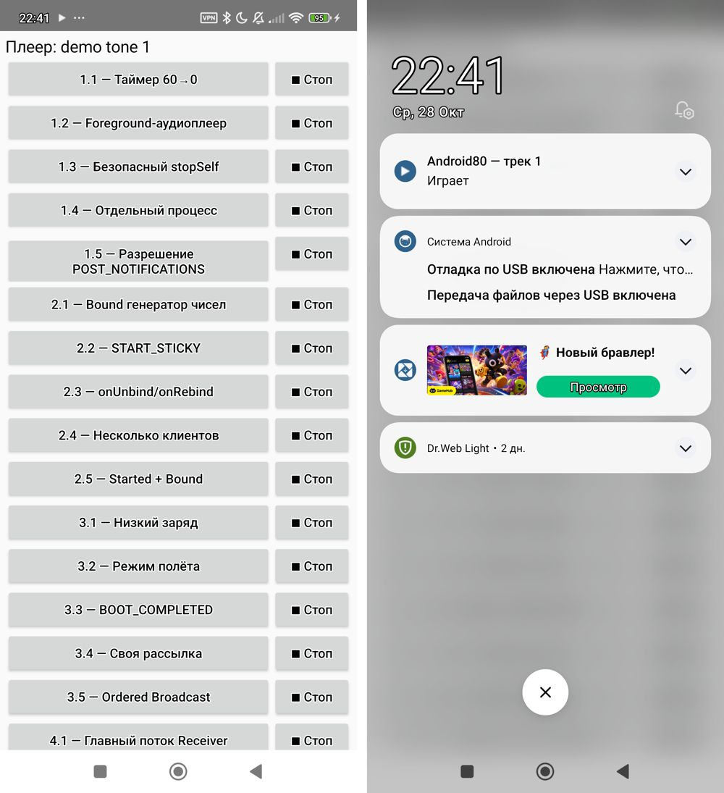

```
22:41:39.166 I/A80_32  (19284): START
22:41:39.327 I/A80_2   (19284): action=com.university.app.player.PLAY track=0
22:41:39.364 I/A80_32  (19284): Bound media player connected
```

---

## 33. Задание 3 из 50

3. **Сервис пакетной выгрузки фотографий:** Напишите службу скачивания архива из 100 файлов с флагом `START_REDELIVER_INTENT` и отображением прогресс-бара в процентах.

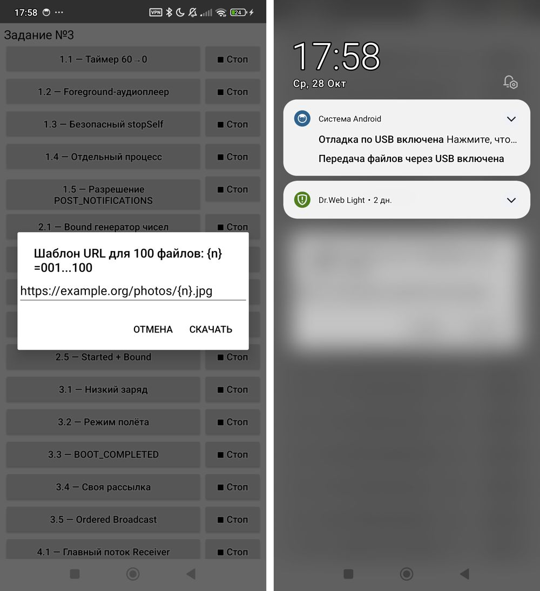

```
17:58:12.423 I/A80_33  (11104): START
```

---

## 34. Задание 4 из 50

4. **Фоновый веб-сокет клиент:** Создайте сервис с непрерывным WebSocket-соединением для получения биржевых котировок, автоматически восстанавливающий связь при падении.

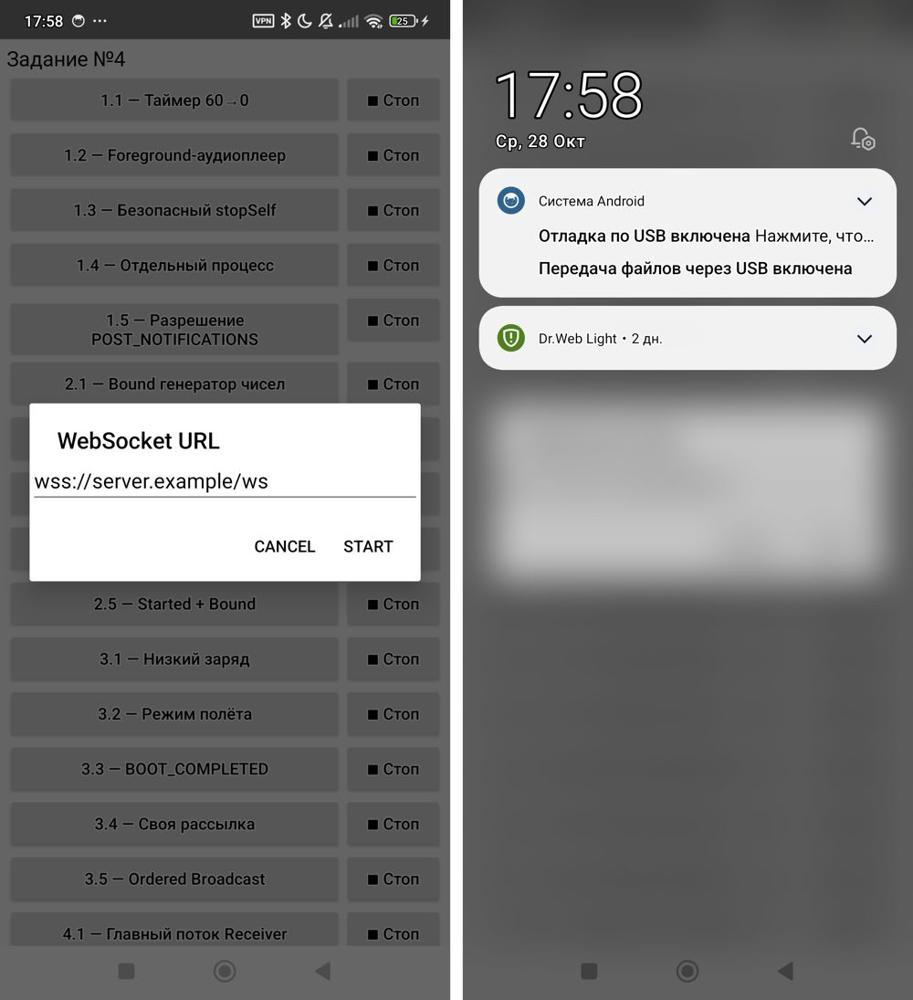

```
17:58:19.448 I/A80_34  (11217): START
```

---

## 35. Задание 5 из 50

5. **Сервис геозоны (Geofencing Monitor):** Разработайте сервис, непрерывно запрашивающий GPS-координаты и подающий звуковой сигнал при выходе из радиуса 500 метров от склада.


```
17:58:26.448 I/A80_35  (11314): START
```

---

## 36. Задание 6 из 50

6. **Служба сжатия видеофайлов:** Напишите сервис с очередью задач на перекодирование видеороликов с использованием фонового пула `Executors.newSingleThreadExecutor()`.

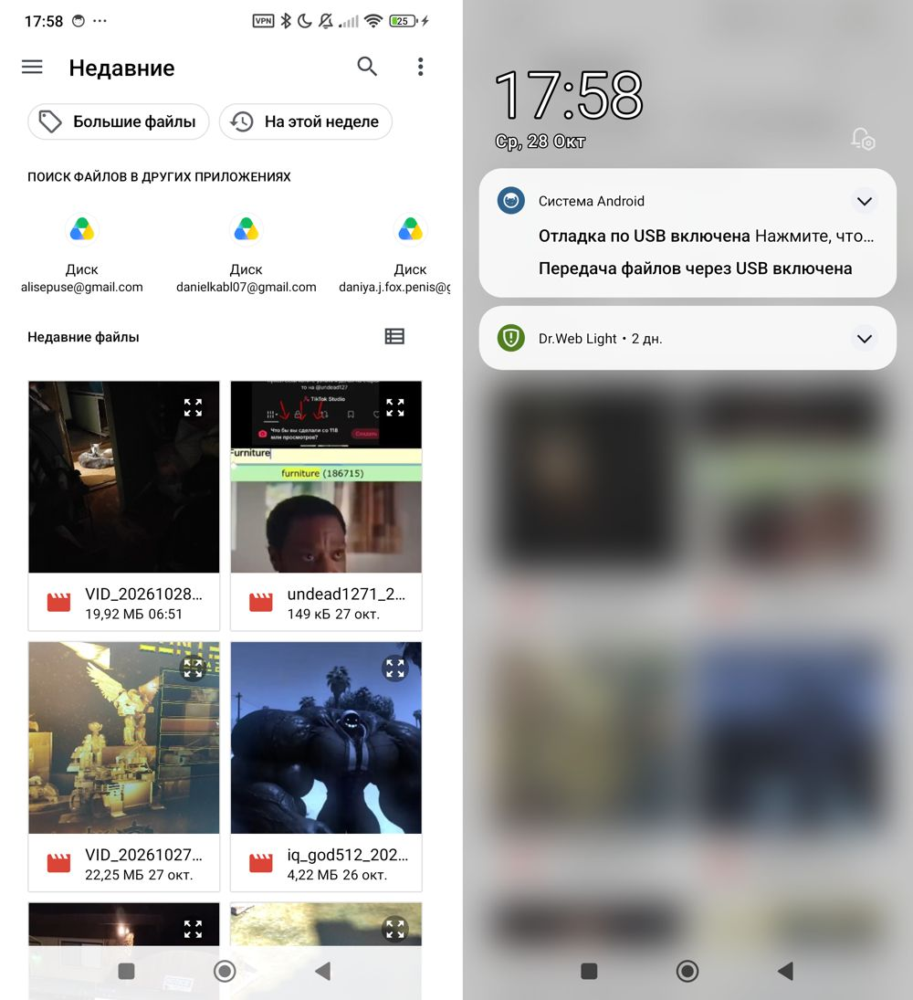

```
17:58:33.382 I/A80_36  (11403): START
```

---

## 37. Задание 7 из 50

7. **IPC через Messenger:** Создайте службу, взаимодействующую с клиентами из другого процесса с помощью объектов `Messenger` и сообщений `Message`.

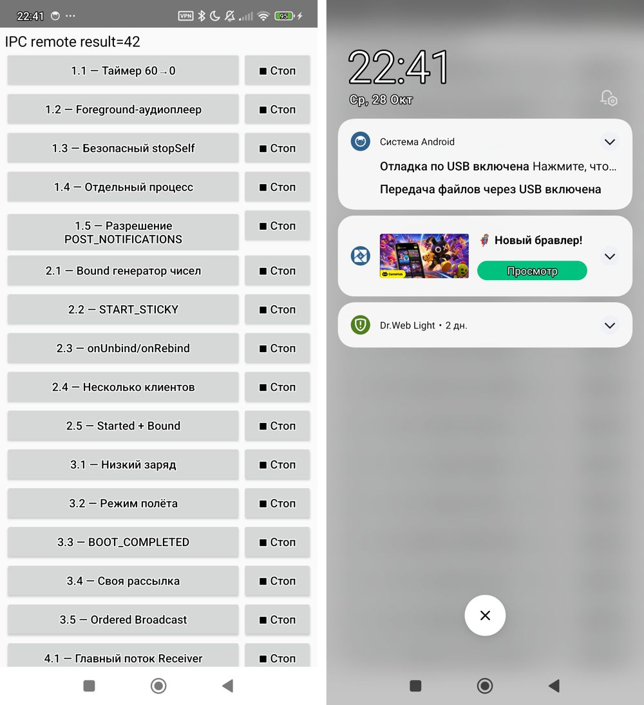

```
22:41:47.286 I/A80_37  (19392): START
22:41:47.594 I/A80_37  (19392): remote reply=42
```

---

## 38. Задание 8 из 50

8. **Служба очистки кэша по расписанию:** Реализуйте сервис, подсчитывающий размер каталога кэша и удаляющий файлы старше 7 дней при старте.

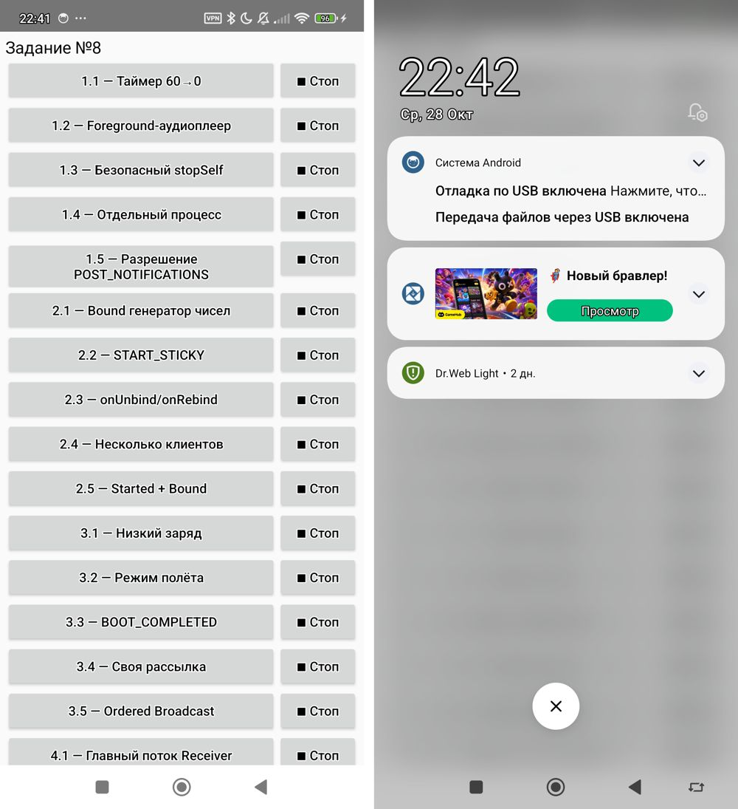

```
22:41:55.389 I/A80_38  (19510): START
22:41:55.431 I/A80_8   (19510): freed_bytes=0
```

---

## 39. Задание 9 из 50

9. **Служба мониторинга буфера обмена:** Разработайте сервис, отслеживающий появление в буфере обмена телефонных номеров и предлагающий быстрый звонок.

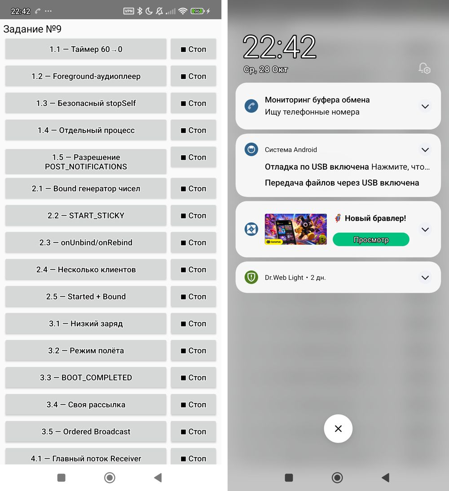

```
22:42:03.545 I/A80_39  (19606): START
22:42:03.590 I/A80_9   (19606): clipboard listener on
```

---

## 40. Задание 10 из 50

10. **Ограничитель времени работы сервиса:** Реализуйте авто-остановку Foreground-службы через 30 минут работы с помощью таймера и метода `stopForeground(true)`.

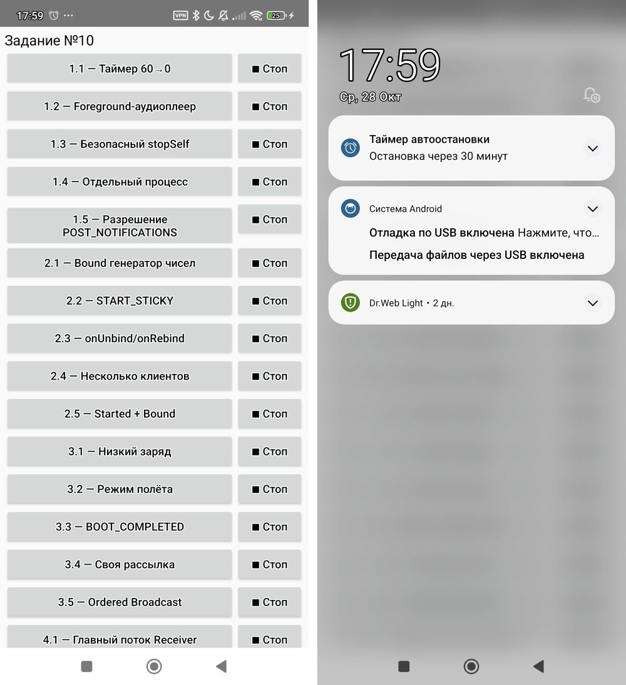

```
17:59:05.438 I/A80_40  (11693): START
```

---

## 41. Задание 11 из 50

11. **Детектор подключения зарядного устройства:** Зарегистрируйте приемник событий `ACTION_POWER_CONNECTED` и `ACTION_POWER_DISCONNECTED` с выводом текущего типа зарядки (быстрая, беспроводная, USB).


```
17:59:12.379 I/A80_41  (11788): START
```

---

## 42. Задание 12 из 50

12. **Монитор изменения часового пояса:** Напишите приемник `ACTION_TIMEZONE_CHANGED`, пересчитывающий время локальных будильников при перелете пользователя.

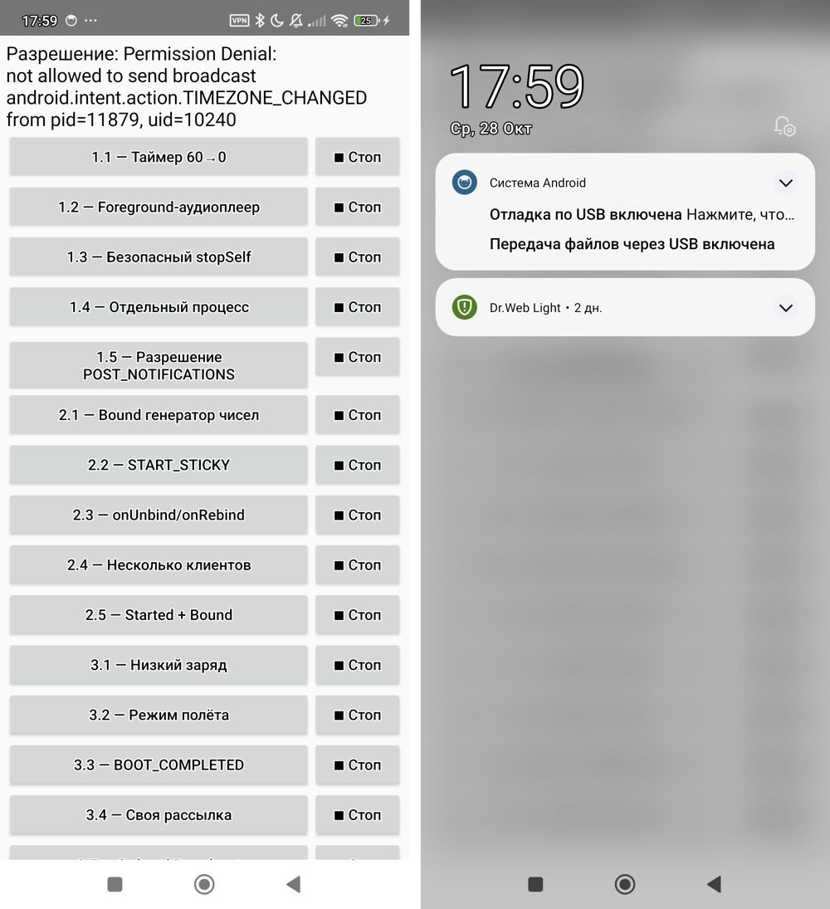

```
17:59:19.383 I/A80_42  (11879): START
17:59:19.386 E/A80_42  (11879): Permission missing
17:59:19.386 E/A80_42  (11879): java.lang.SecurityException: Permission Denial: not allowed to send broadcast android.intent.action.TIMEZONE_CHANGED from pid=11879, uid=10240
17:59:19.386 E/A80_42  (11879): 	at android.os.Parcel.createExceptionOrNull(Parcel.java:3079)
17:59:19.386 E/A80_42  (11879): 	at android.os.Parcel.createException(Parcel.java:3063)
17:59:19.386 E/A80_42  (11879): 	at android.os.Parcel.readException(Parcel.java:3046)
17:59:19.386 E/A80_42  (11879): 	at android.os.Parcel.readException(Parcel.java:2988)
17:59:19.386 E/A80_42  (11879): 	at android.app.IActivityManager$Stub$Proxy.broadcastIntentWithFeature(IActivityManager.java:6296)
17:59:19.386 E/A80_42  (11879): 	at android.app.ContextImpl.sendBroadcast(ContextImpl.java:1235)
17:59:19.386 E/A80_42  (11879): 	at android.content.ContextWrapper.sendBroadcast(ContextWrapper.java:515)
```

---

## 43. Задание 13 из 50

13. **Перехватчик исходящих SMS (Служебный режим):** Сконфигурируйте ресивер для обработки событий телеком-модуля при наличии соответствующих прав.

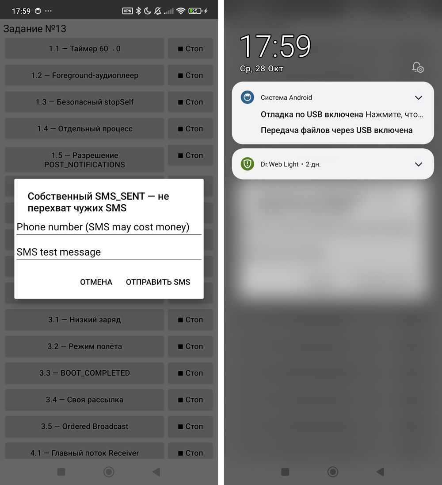

```
17:59:26.329 I/A80_43  (11971): START
17:59:26.400 E/A80_43  (11971): Permission missing
17:59:26.400 E/A80_43  (11971): java.lang.SecurityException: Requesting android.permission.SEND_SMS
17:59:26.400 E/A80_43  (11971): 	at com.university.app.TaskActions.permission(TaskActions.java:338)
17:59:26.400 E/A80_43  (11971): 	at com.university.app.TaskActions.perform(TaskActions.java:562)
17:59:26.400 E/A80_43  (11971): 	at com.university.app.MainActivity.execute(MainActivity.java:74)
17:59:26.400 E/A80_43  (11971): 	at com.university.app.MainActivity.lambda$onCreate$2(MainActivity.java:68)
17:59:26.400 E/A80_43  (11971): 	at com.university.app.MainActivity.$r8$lambda$PJGrs3LOr6nfhPVE2TXfKb3U7gs(MainActivity.java:0)
17:59:26.400 E/A80_43  (11971): 	at com.university.app.MainActivity$$ExternalSyntheticLambda2.run(D8$$SyntheticClass:0)
17:59:26.400 E/A80_43  (11971): 	at android.os.Handler.handleCallback(Handler.java:958)
```

---

## 44. Задание 14 из 50

14. **Сигнализатор переполнения памяти накопителя:** Напишите приемник системного действия `ACTION_DEVICE_STORAGE_LOW`, автоматически инициирующий сброс временных картинок.


```
17:59:33.346 I/A80_44  (12145): START
17:59:33.382 W/A80_14  (12145): Storage low -> remove temporary images
17:59:33.463 I/A80_14  (12145): storage low temp images removed=0
```

---

## 45. Задание 15 из 50

15. **Автоматический запуск службы после перезагрузки:** Настройте цепочку: прием события `BOOT_COMPLETED` -> валидация настроек -> вызов `startForegroundService()`.


```
17:59:40.360 I/A80_45  (12249): START
17:59:40.409 I/A80_BOOT(12249): boot=com.university.app.TEST_BOOT_AUTOSTART
17:59:40.428 I/A80_15  (12249): startForegroundService(TimedForegroundService)
17:59:40.502 I/A80_4_4 (12249): saved last_boot
17:59:40.502 I/A80_8   (12249): deleted=0
```

---

## 46. Задание 16 из 50

16. **Перехват подключения гарнитуры:** Напишите приемник события `ACTION_HEADSET_PLUG`, автоматически ставящий аудиоплеер на паузу при извлечении наушников.

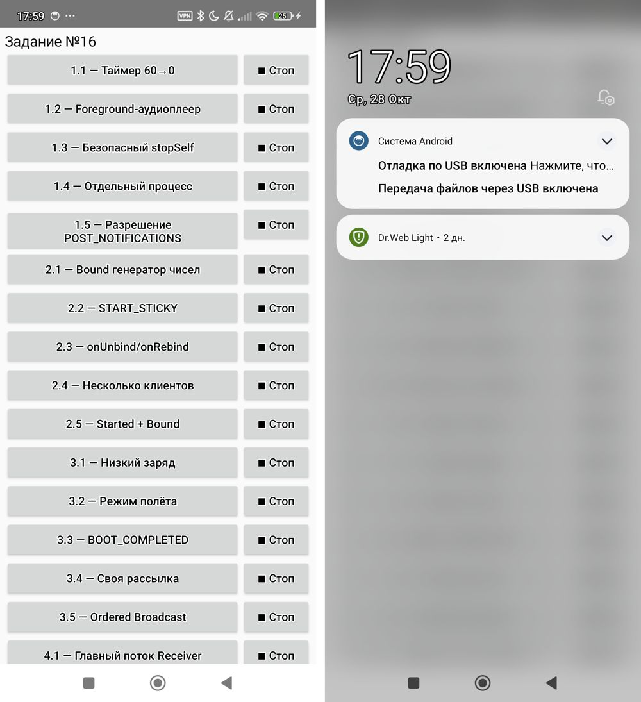

```
17:59:47.318 I/A80_46  (12344): START
17:59:47.354 I/A80_16  (12344): headset unplugged
17:59:47.354 I/A80_16  (12344): player not running
```

---

## 47. Задание 17 из 50

17. **Локальный шифратор широковещательных сообщений:** Реализуйте отправку сообщений, подписанных цифровой подписью, с проверкой в ресивере через кастомное разрешение уровня `signature`.


```
17:59:54.304 I/A80_47  (12432): START
17:59:54.468 I/A80_17  (12432): ECDSA signed message sent
17:59:54.504 I/A80_17  (12432): ECDSA verified=true
```

---

## 48. Задание 18 из 50

18. **Индикатор изменения системного языка:** Сконфигурируйте ресивер действия `ACTION_LOCALE_CHANGED` для мгновенной переинициализации локализованных кэшей.

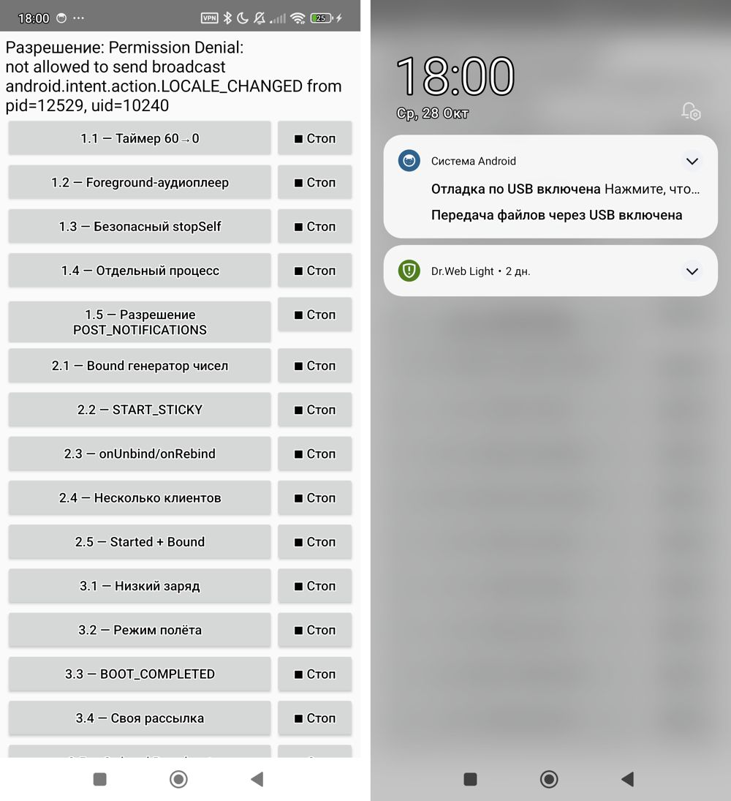

```
18:00:01.286 I/A80_48  (12529): START
18:00:01.289 E/A80_48  (12529): Permission missing
18:00:01.289 E/A80_48  (12529): java.lang.SecurityException: Permission Denial: not allowed to send broadcast android.intent.action.LOCALE_CHANGED from pid=12529, uid=10240
18:00:01.289 E/A80_48  (12529): 	at android.os.Parcel.createExceptionOrNull(Parcel.java:3079)
18:00:01.289 E/A80_48  (12529): 	at android.os.Parcel.createException(Parcel.java:3063)
18:00:01.289 E/A80_48  (12529): 	at android.os.Parcel.readException(Parcel.java:3046)
18:00:01.289 E/A80_48  (12529): 	at android.os.Parcel.readException(Parcel.java:2988)
18:00:01.289 E/A80_48  (12529): 	at android.app.IActivityManager$Stub$Proxy.broadcastIntentWithFeature(IActivityManager.java:6296)
18:00:01.289 E/A80_48  (12529): 	at android.app.ContextImpl.sendBroadcast(ContextImpl.java:1235)
18:00:01.289 E/A80_48  (12529): 	at android.content.ContextWrapper.sendBroadcast(ContextWrapper.java:515)
```

---

## 49. Задание 19 из 50

19. **Динамический фильтр бродкастов с приоритетом:** Создайте 3 приемника в разных модулях и продемонстрируйте передачу модифицированных результатов через `setResultData()`.


```
18:00:08.304 I/A80_49  (12623): START
18:00:08.306 I/A80_15  (12623): ordered sent
18:00:08.343 I/A80_3_5 (12623): priority 200
18:00:08.396 I/A80_19  (12623): priority 150 result=high->mid
18:00:08.417 I/A80_19  (12623): priority 100 result=high->mid->low
```

---

## 50. Задание 20 из 50

20. **Антикраш-ресивер с таймаутом:** Оберните логику `onReceive()` в контролируемый асинхронный контекст `goAsync()` с принудительным завершением через 8 секунд.


```
18:00:15.398 I/A80_50  (12728): START
```

---

## 51. Задание 21 из 50

21. **Провайдер безопасного доступа к логам:** Спроектируйте `ContentProvider` с правами только на чтение (`readPermission`), отдающий зашифрованные логи приложения аналитическому сервису.


```
18:00:22.426 I/A80_51  (12835): START
18:00:22.491 I/A80_21  (12835): encrypted log id=1793199622488
18:00:22.491 I/A80_51  (12835): encrypted=content://com.university.app.encryptedlogs/logs/1793199622488
```

---

## 52. Задание 22 из 50

22. **Интеграция с системным поиском (Quick Search Box):** Реализуйте провайдер, возвращающий курсор подсказок по схеме `SearchManager.SUGGEST_URI_PATH_QUERY`.


```
18:00:29.480 I/A80_52  (12929): START
18:00:29.487 I/A80_100 (12929): Insert content://com.university.app.notes/notes/14
```

---

## 53. Задание 23 из 50

23. **Экспорт визитных карточек (vCard):** Создайте провайдер, отдающий файлы контактов в формате `.vcf` через метод `openFile()`.

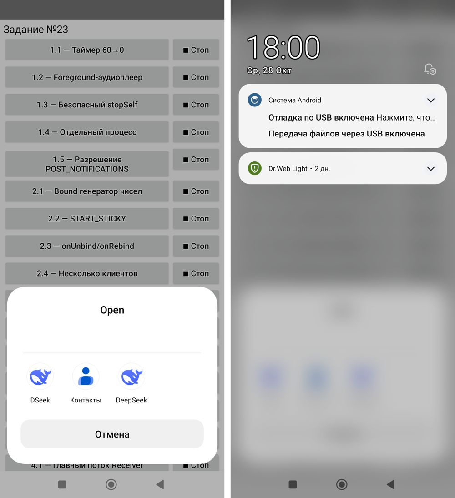

```
18:00:36.543 I/A80_53  (13024): START
18:00:36.579 I/A80_29  (13024): done
```

---

## 54. Задание 24 из 50

24. **Синхронизация корзины между двумя приложениями:** Разработайте два разных приложения одной компании, где второе читает состав корзины первого через `ContentResolver`.

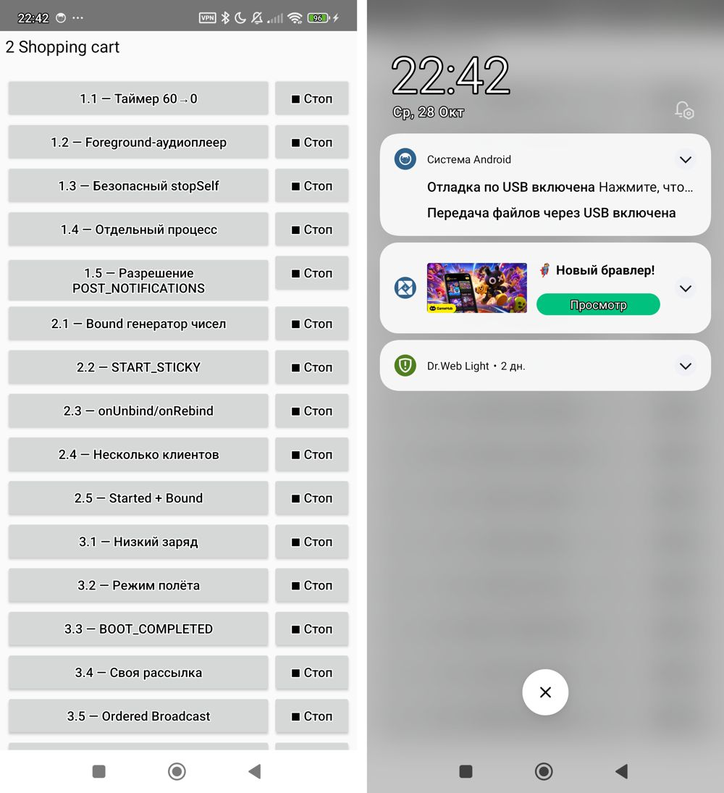

```
22:42:11.605 I/A80_54  (19709): START
22:42:11.611 I/A80_100 (19709): Insert content://com.university.app.notes/notes/2
```

---

## 55. Задание 25 из 50

25. **Провайдер конфигураций приложения:** Реализуйте шифрованный поставщик настроек, хранящий пары «ключ-значение» в защищенном хранилище EncryptedSharedPreferences.

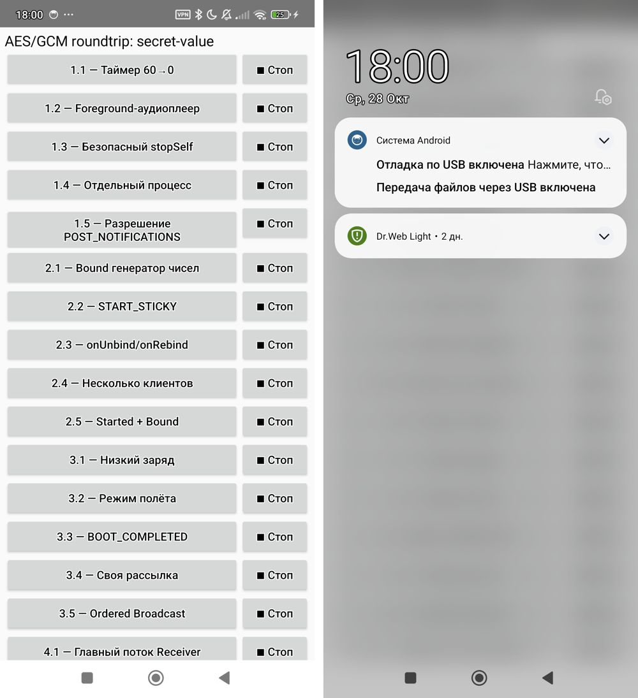

```
18:00:51.886 I/A80_55  (13169): START
18:00:51.933 I/A80_25  (13169): AES/GCM roundtrip OK
```

---

## 56. Задание 26 из 50

26. **Передача снимка с камеры через FileProvider:** Настройте генерацию безопасного `content://` URI для сохранения полноразмерного фото стандартным приложением камеры.

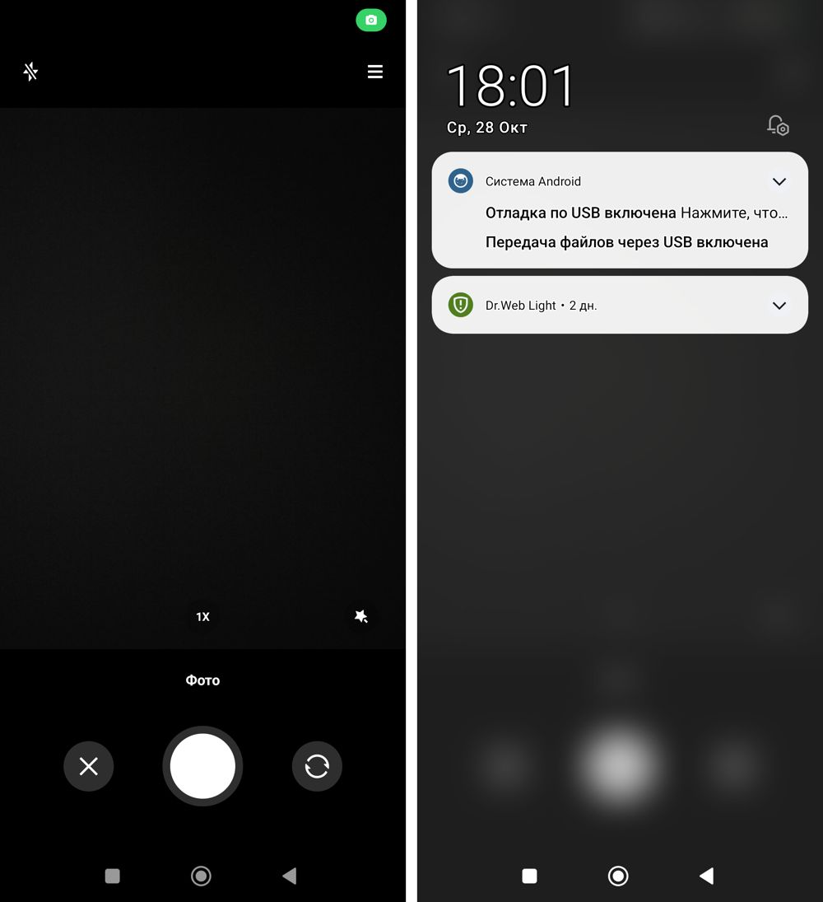

```
18:00:58.877 I/A80_56  (13288): START
```

---

## 57. Задание 27 из 50

27. **Пакетная вставка 10 000 строк:** Оптимизируйте метод `bulkInsert()` в кастомном провайдере для быстрой загрузки каталога товаров в базу данных.


```
22:42:19.680 I/A80_57  (19808): START
22:42:20.415 I/A80_27  (19808): insert=10000 ms=707
22:42:20.415 I/A80_27  (19808): done
```

---

## 58. Задание 28 из 50

28. **Провайдер с поддержкой MIME-типов PDF и CSV:** Реализуйте метод `getStreamTypes()` для отдачи отчетов в нескольких форматах по выбору клиента.

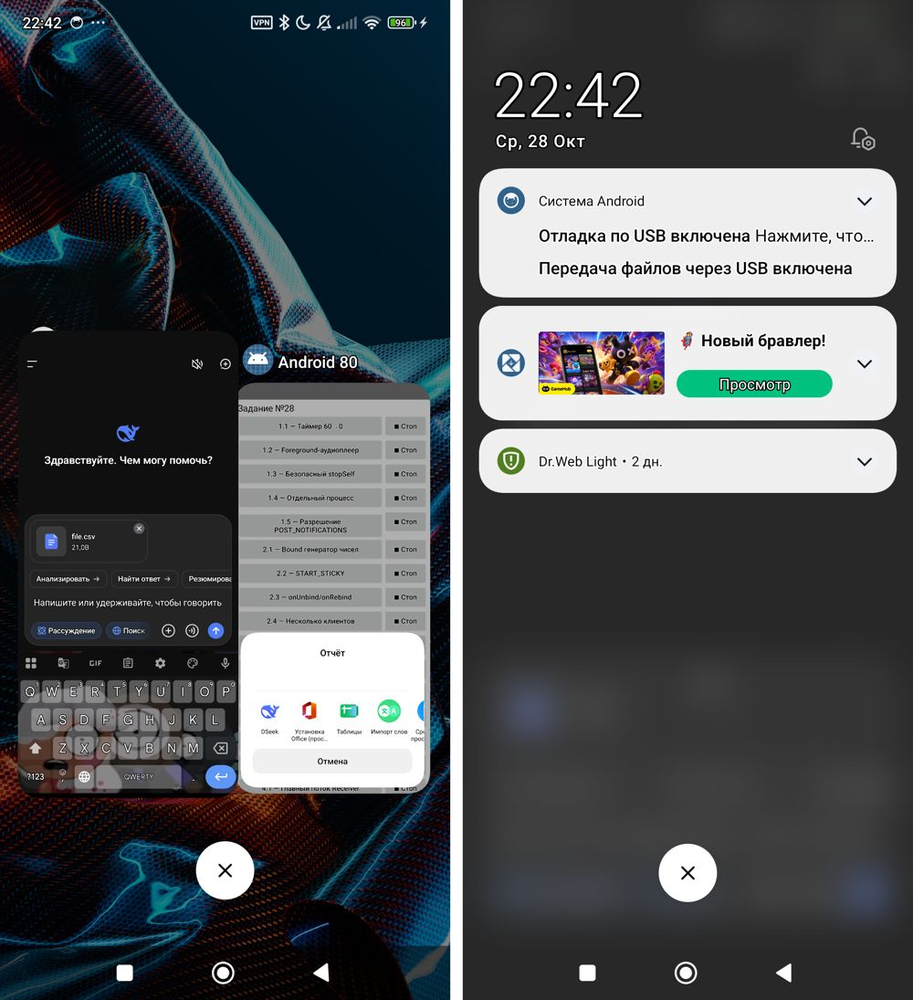

```
22:42:27.782 I/A80_58  (19907): START
22:42:27.783 I/A80_58  (19907): stream types=[application/pdf, text/csv]
22:42:30.940 I/A80_28  (19907): opened: /data/user/0/com.university.app/cache/report.csv
22:42:31.449 I/A80_28  (19907): opened: /data/user/0/com.university.app/cache/report.csv
```

---

## 59. Задание 29 из 50

29. **Мониторинг базы данных через ContentObserver:** Напишите сервис, слушающий изменения в системном журнале звонков и ведущий статистику вызовов.

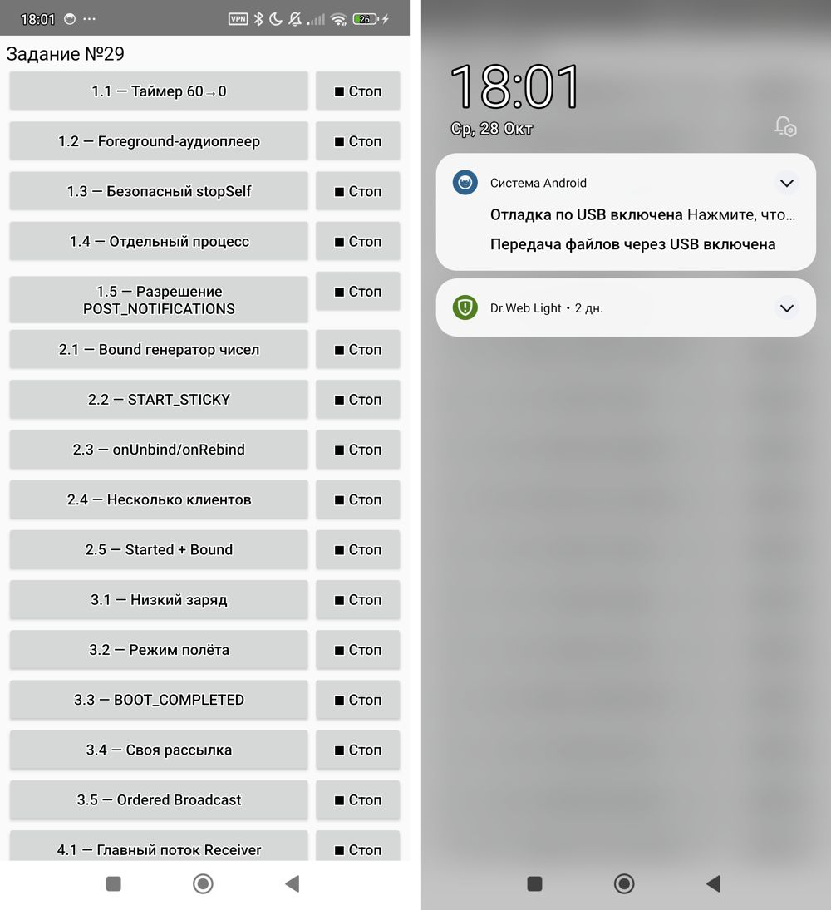

```
18:01:22.027 I/A80_59  (14087): START
18:01:22.061 I/A80_29  (14087): call log observer enabled
18:01:22.138 I/A80_29  (14087): статистика: входящих=339 исходящих=403 пропущенных=335 всего секунд разговора=43207
```

---

## 60. Задание 30 из 50

30. **Полнотекстовый поиск по заметкам:** Спроектируйте ContentProvider над таблицей виртуальной полнотекстовой базы SQLite FTS4.


```
18:01:29.104 I/A80_60  (14174): START
18:01:29.111 I/A80_100 (14174): Insert content://com.university.app.notes/notes/15
```

---

## 61. Задание 31 из 50

31. **Комплекс «Фоновый загрузчик»:** Activity запускает Service скачивания -> Service по окончании рассылает Broadcast -> Receiver обновляет UI или показывает пуш.

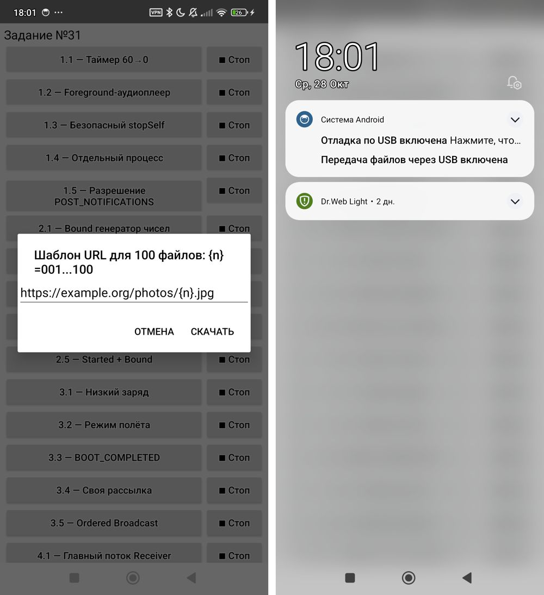

```
18:01:36.040 I/A80_61  (14262): START
18:01:40.397 E/A80_3   (14262): item=1
18:01:40.397 E/A80_3   (14262): java.io.IOException: HTTP 404
18:01:40.397 E/A80_3   (14262): 	at com.university.app.DownloadForegroundService.lambda$onStartCommand$0(DownloadForegroundService.java:58)
18:01:40.397 E/A80_3   (14262): 	at com.university.app.DownloadForegroundService.$r8$lambda$ejZsq9GoJ5W0sRiHSMBQWvonM-A(DownloadForegroundService.java:0)
18:01:40.397 E/A80_3   (14262): 	at com.university.app.DownloadForegroundService$$ExternalSyntheticLambda0.run(D8$$SyntheticClass:0)
18:01:40.397 E/A80_3   (14262): 	at java.util.concurrent.ThreadPoolExecutor.runWorker(ThreadPoolExecutor.java:1100)
18:01:40.397 E/A80_3   (14262): 	at java.util.concurrent.ThreadPoolExecutor$Worker.run(ThreadPoolExecutor.java:624)
18:01:40.397 E/A80_3   (14262): 	at java.lang.Thread.run(Thread.java:1571)
18:01:40.593 E/A80_3   (14262): item=2
```

---

## 62. Задание 32 из 50

32. **Комплекс «Аварийный сброс»:** Ресивер низкого заряда батареи останавливает тяжелые фоновые службы синхронизации и переводит провайдер данных в режим энергосбережения.


```
18:01:43.057 I/A80_62  (14369): START
18:01:43.113 W/A80_32  (14369): heavy services stopped; provider power_save=true
```

---

## 63. Задание 33 из 50

33. **Комплекс «Кэширующий прокси»:** ContentProvider при отсутствии данных в локальной БД обращается к Service для фонового запроса в сеть и уведомляет UI через `notifyChange()`.


```
18:01:50.120 I/A80_63  (14459): START
18:01:50.683 I/A80_33  (14459): background fetch complete
18:01:50.688 I/A80_33  (14459): notifyChange UI refreshed
```

---

## 64. Задание 34 из 50

34. **Удаленное управление сервисом через Broadcast:** Реализуйте управление плеером (Play/Stop/Mute) путем отправки внешних интентов из тестового консольного скрипта `adb shell am broadcast`.

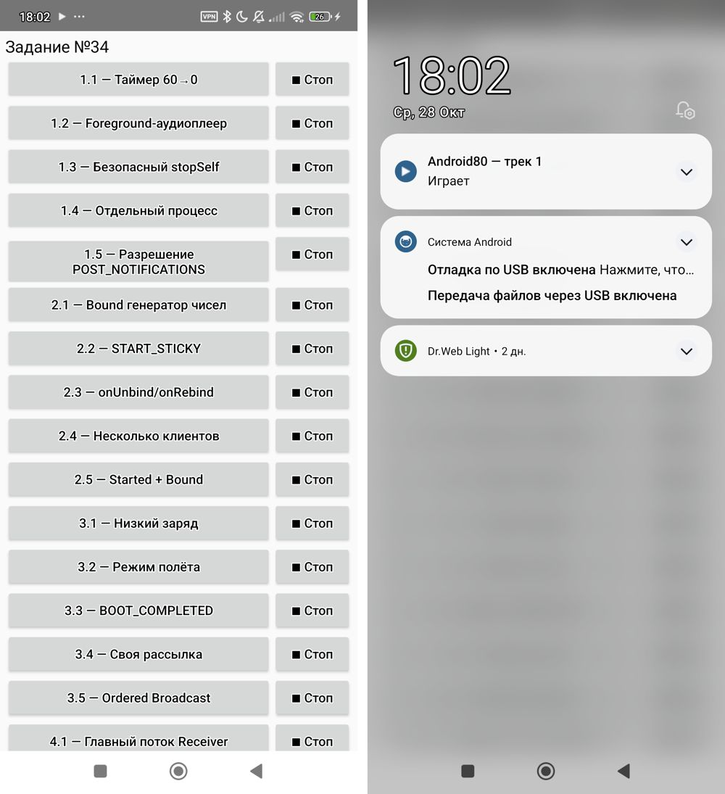

```
18:01:57.005 I/A80_64  (14556): START
18:01:57.040 I/A80_34  (14556): received=com.university.app.PLAY
18:01:57.305 I/A80_2   (14556): action=com.university.app.player.PLAY track=0
```

---

## 65. Задание 35 из 50

35. **Двусторонняя связь Activity и Bound Service:** Настройте паттерн Callback/Listener, чтобы служба сама уведомляла экран о появлении новых данных датчиков.


```
18:02:04.054 I/A80_65  (14661): START
18:02:04.155 I/A80_65  (14661): callback attached
18:02:04.317 I/A80_35  (14661): accelerometer_x=-0.36191443
18:02:04.517 I/A80_35  (14661): accelerometer_x=-0.36490545
18:02:04.717 I/A80_35  (14661): accelerometer_x=-0.36370903
18:02:04.917 I/A80_35  (14661): accelerometer_x=-0.36311084
18:02:05.119 I/A80_35  (14661): accelerometer_x=-0.36011982
18:02:05.315 I/A80_35  (14661): accelerometer_x=-0.36011982
18:02:05.516 I/A80_35  (14661): accelerometer_x=-0.36251262
18:02:05.717 I/A80_35  (14661): accelerometer_x=-0.36011982
```

---

## 66. Задание 36 из 50

36. **Автоматический бэкап базы в файл:** По сигналу системного времени (`ACTION_TIME_TICK`) сервис считывает данные из ContentProvider и сохраняет их в JSON-архив.


```
18:02:11.004 I/A80_66  (14772): START
18:02:11.074 I/A80_36  (14772): Saved /data/user/0/com.university.app/files/backup.json
18:02:11.074 I/A80_36  (14772): Backup triggered by tick
```

---

## 67. Задание 37 из 50

37. **Контроль доступа к компонентам по белому списку пакетов:** Проверяйте имя вызывающего пакета через `Binder.getCallingUid()` и `PackageManager.getNameForUid()`.

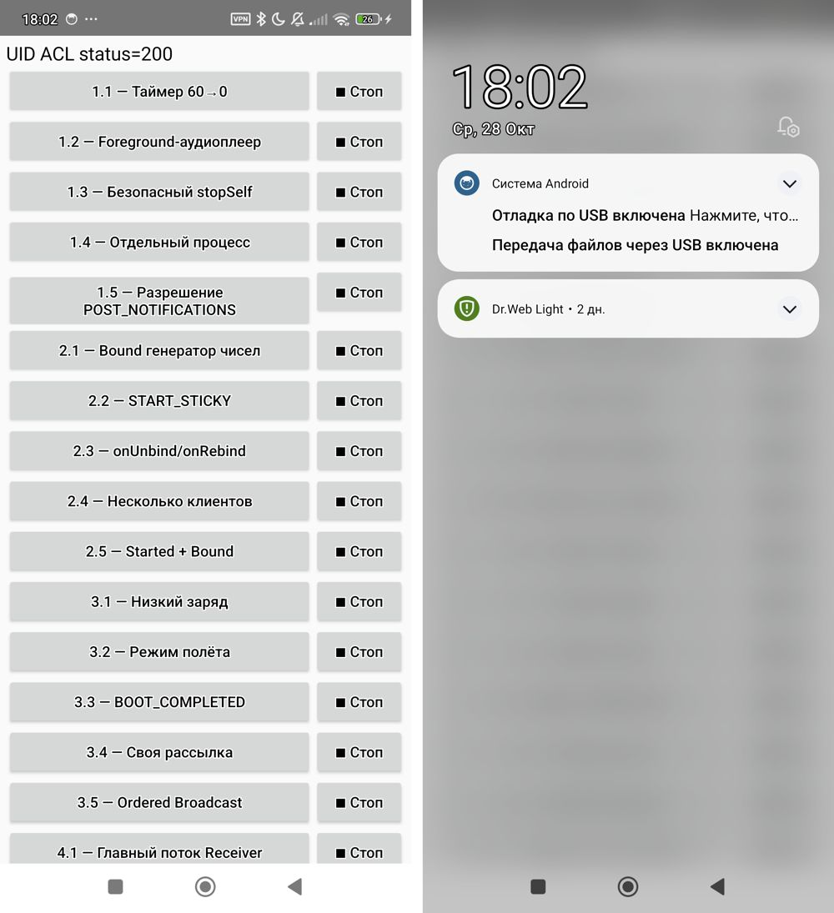

```
18:02:17.965 I/A80_67  (14863): START
18:02:18.095 I/A80_37  (14863): caller UID=10240 name=com.university.app allow=true
18:02:18.113 I/A80_37  (14863): UID decision: 200
```

---

## 68. Задание 38 из 50

38. **Передача дескрипторов файлов (PipeDataWriter):** Реализуйте передачу потоковых данных из сервиса в провайдер без сохранения промежуточного файла на диск через канал `ParcelFileDescriptor.createPipe()`.


```
18:02:24.966 I/A80_68  (14949): START
18:02:24.970 E/A80_38  (14949): stream
18:02:24.970 E/A80_38  (14949): java.io.FileNotFoundException: java.lang.RuntimeException: Not allowed to write file descriptors here
18:02:24.970 E/A80_38  (14949): 	at com.university.app.StreamProvider.openFile(StreamProvider.java:27)
18:02:24.970 E/A80_38  (14949): 	at android.content.ContentProvider.openAssetFile(ContentProvider.java:2252)
18:02:24.970 E/A80_38  (14949): 	at android.content.ContentProvider.openTypedAssetFile(ContentProvider.java:2430)
18:02:24.970 E/A80_38  (14949): 	at android.content.ContentProvider.openTypedAssetFile(ContentProvider.java:2497)
18:02:24.970 E/A80_38  (14949): 	at android.content.ContentProvider$Transport.openTypedAssetFile(ContentProvider.java:673)
18:02:24.970 E/A80_38  (14949): 	at android.content.ContentResolver.openTypedAssetFileDescriptor(ContentResolver.java:2045)
18:02:24.970 E/A80_38  (14949): 	at android.content.ContentResolver.openAssetFileDescriptor(ContentResolver.java:1860)
```

---

## 69. Задание 39 из 50

39. **Имитация системного будильника:** Соберите связку из `AlarmManager`, BroadcastReceiver и высокоприоритетного Foreground Service для пробуждения экрана.

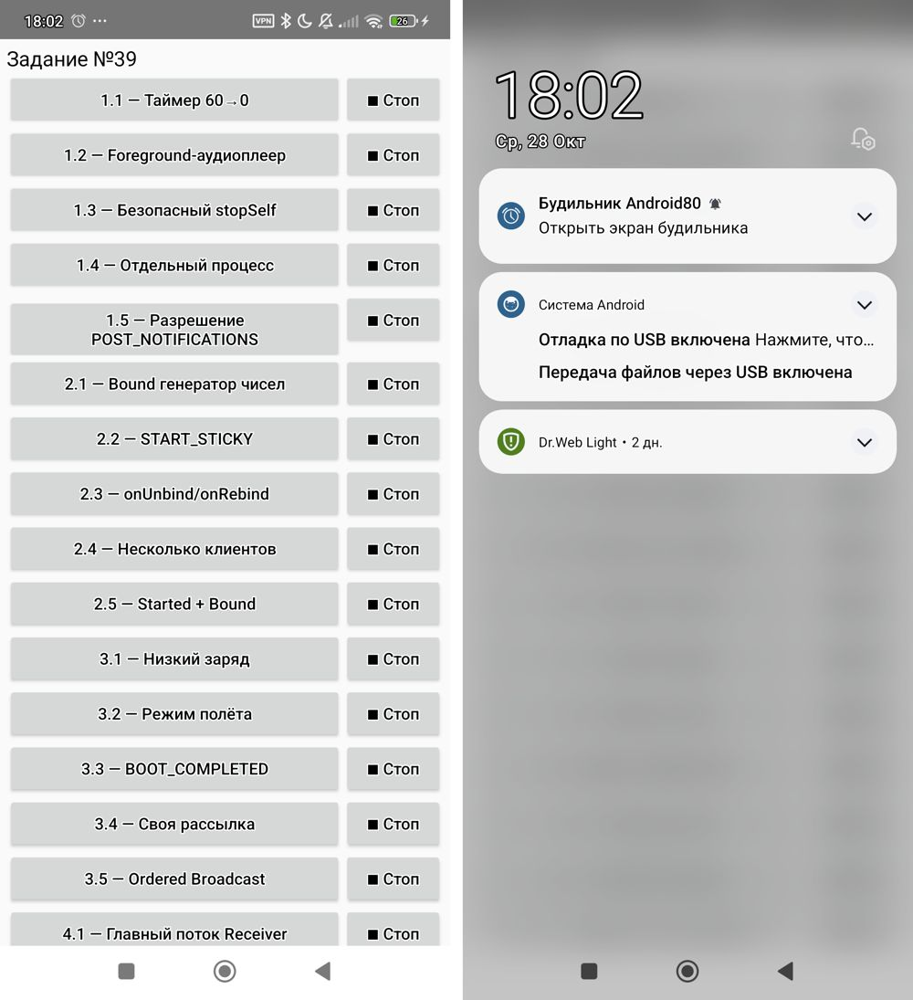

```
18:02:31.982 I/A80_69  (15034): START
```

---

## 70. Задание 40 из 50

40. **Динамическое отключение компонентов:** Реализуйте включение и выключение BroadcastReceiver во время работы через метод `PackageManager.setComponentEnabledSetting()`.


```
18:02:47.991 I/A80_70  (15168): START
18:02:47.993 I/A80_40  (15168): enabled=false
```

---

## 71. Задание 41 из 50

41. **Защита от атак повторного воспроизведения (Broadcast Replay Attack):** Добавьте проверку таймстемпа и случайной одноразовой соли (Nonce) в широковещательные интенты.


```
18:02:55.024 I/A80_71  (15302): START
18:02:55.087 I/A80_41  (15302): accepted
18:02:55.142 I/A80_41  (15302): replay rejected
```

---

## 72. Задание 42 из 50

42. **Изоляция провайдера от обхода путей (Path Traversal):** Напишите валидатор путей в методе `openFile()`, блокирующий попытки извлечения файлов через последовательности `../`.


```
18:03:02.053 I/A80_72  (15436): START
18:03:02.055 I/A80_72  (15436): Path traversal blocked: java.lang.SecurityException: .. path rejected
```

---

## 73. Задание 43 из 50

43. **Ограничение прав на чтение и запись:** Настройте в манифесте для провайдера раздельные атрибуты `android:readPermission` и `android:writePermission`.

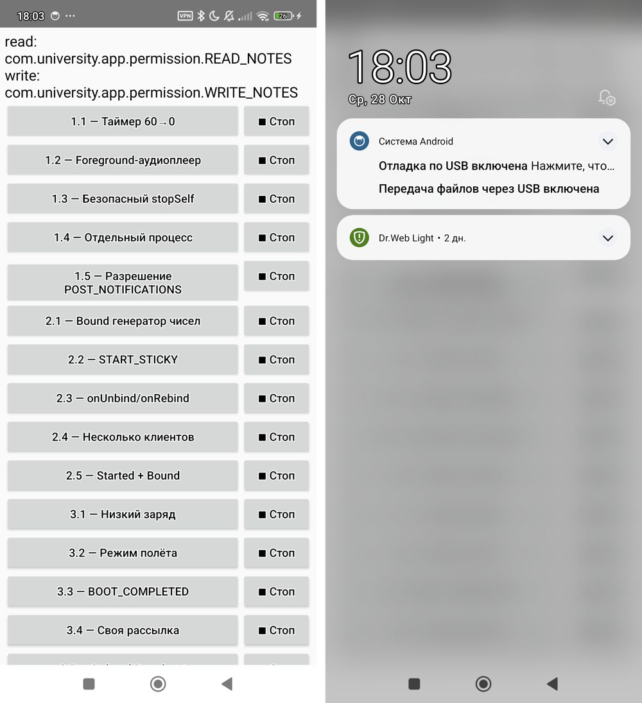

```
18:03:08.993 I/A80_73  (15523): START
18:03:08.994 I/A80_73  (15523): readPermission=com.university.app.permission.READ_NOTES
18:03:08.994 I/A80_73  (15523): writePermission=com.university.app.permission.WRITE_NOTES
```

---

## 74. Задание 44 из 50

44. **Профилирование утечек памяти в сервисах:** Проанализируйте длительно работающий сервис на предмет удержания ссылок на уничтоженные Activity через статические поля.

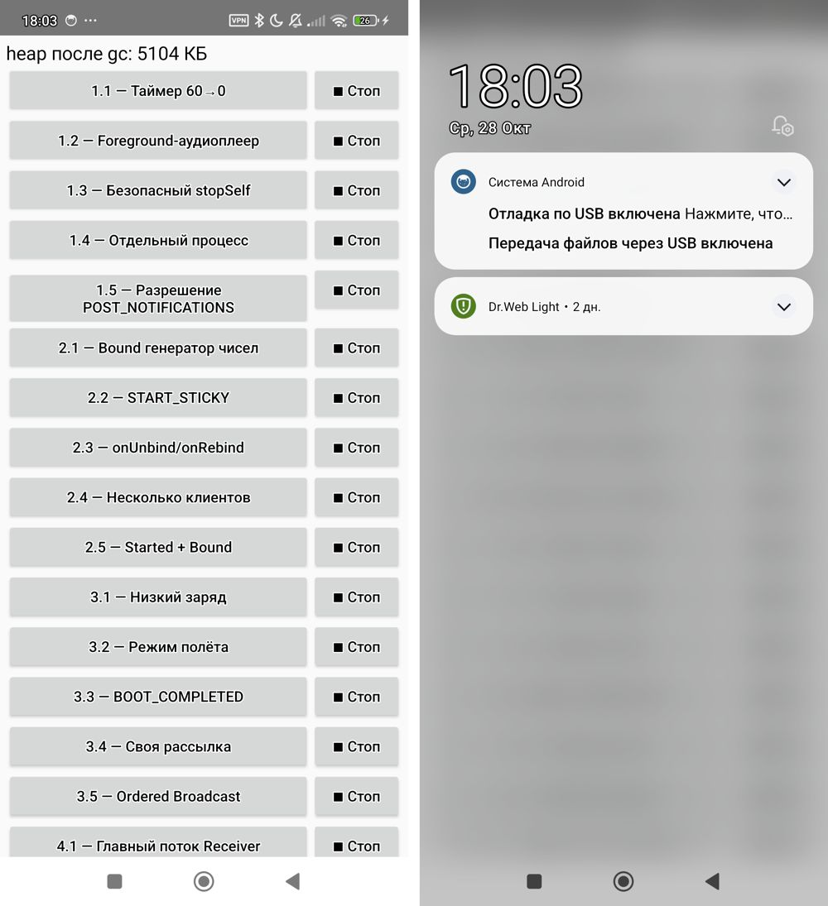

```
18:03:16.005 I/A80_74  (15617): START
18:03:16.025 I/A80_74  (15617): heap до gc=7325 КБ, после=5104 КБ
18:03:17.533 I/A80_74  (15617): heap dump: /storage/emulated/0/Android/data/com.university.app/files/services.hprof
18:03:20.675 I/A80_44  (15617): Activity уничтожена, но жива в памяти: true (держит static LeakProbeService.held=true)
18:03:20.689 I/A80_44  (15617): после held=null Activity собрана GC: false
```

---

## 75. Задание 45 из 50

45. **Адаптация сервисов под режим глубокого сна (Doze Mode):** Реализуйте корректную обработку перехода устройства в спящий режим и использование `PowerManager.WakeLock` с обязательным таймаутом.


```
18:03:23.291 I/A80_75  (15757): START
18:03:23.422 I/A80_45  (15757): powerSave=false idle=false
18:03:24.423 I/A80_45  (15757): WakeLock released
```

---

## 76. Задание 46 из 50

46. **Защита от неконтролируемого запуска службы:** Сделайте сервис недоступным для внешних приложений (`android:exported="false"`), защитив его от Intent Injection.


```
18:03:29.964 I/A80_76  (16103): START
18:03:29.966 I/A80_76  (16103): DemoService exported=false
```

---

## 77. Задание 47 из 50

47. **Отказоустойчивость при падении SQLite:** Оберните все операции провайдера контента в обработку `SQLiteDatabaseCorruptException` с аварийным пересозданием файла базы данных.


```
18:03:37.451 I/A80_77  (16211): START
18:03:37.493 W/A80_47  (16211): corrupt detected: android.database.sqlite.SQLiteCantOpenDatabaseException: Cannot open database '/data/user/0/com.university.app/cache/broken_test.db' with flags 0x0: File /data/user/0/com.university.app/cache/broken_test.db doesn't exist
18:03:37.494 E/A80_47  (16211): backup failed
18:03:37.502 I/A80_47  (16211): database recovered; damaged copy=/data/user/0/com.university.app/cache/recovery_copy.bak
18:03:37.502 I/A80_77  (16211): done
```

---

## 78. Задание 48 из 50

48. **Контроль энергопотребления датчиков в сервисе:** Реализуйте снижение частоты опроса акселерометра в 10 раз при выключенном дисплее (`ACTION_SCREEN_OFF`).


```
18:03:43.902 I/A80_78  (16979): START
18:03:43.947 I/A80_48  (16979): register accelerometer 20ms on / 200ms off
18:03:43.971 I/A80_48  (16979): period_us=20000 x=-0.37088752
18:03:43.980 I/A80_48  (16979): period_us=20000 x=-0.36131623
18:03:44.009 I/A80_48  (16979): period_us=20000 x=-0.36131623
18:03:44.028 I/A80_48  (16979): period_us=20000 x=-0.37088752
18:03:44.048 I/A80_48  (16979): period_us=20000 x=-0.37088752
18:03:44.067 I/A80_48  (16979): period_us=20000 x=-0.37567315
18:03:44.085 I/A80_48  (16979): period_us=20000 x=-0.36131623
18:03:44.102 I/A80_48  (16979): period_us=20000 x=-0.37088752
```

---

## 79. Задание 49 из 50

49. **Безопасная выдача временных разрешений на URI:** Реализуйте генерацию интента с флагами `FLAG_GRANT_READ_URI_PERMISSION` для передачи фотографии стороннему редактору.

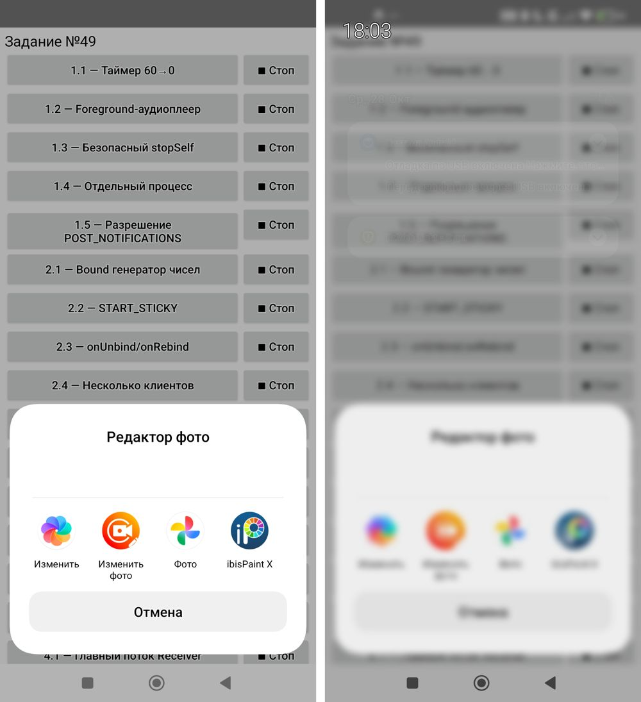

```
18:03:52.692 I/A80_48  (16979): period_us=20000 x=-0.37088752
18:03:52.710 I/A80_48  (16979): period_us=20000 x=-0.37567315
18:03:52.728 I/A80_48  (16979): period_us=20000 x=-0.37088752
18:03:54.243 I/A80_79  (17083): START
18:03:54.267 I/A80_49  (17083): Edit URI=content://com.university.app.files/sharing/edit.png
```

---

## 80. Задание 50 из 50

50. **Комплексная архитектура Enterprise-модуля:**
    - Разработайте защищенный Foreground Service с типом `dataSync`.
    - Подключите локальный ContentProvider с постраничной пагинацией.
    - Настройте динамический BroadcastReceiver для контроля сетевого статуса.
    - Обеспечьте нулевую вероятность возникновения ANR и полную очистку системных ресурсов в методах `onDestroy()`.
---

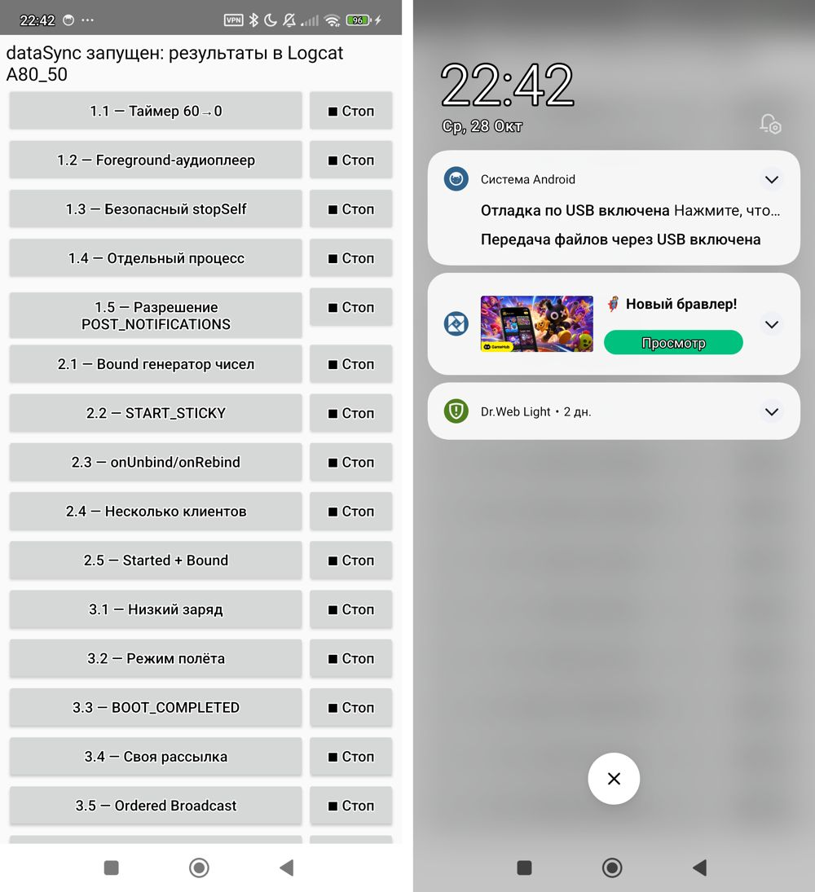

```
22:42:37.317 I/A80_80  (20232): START
22:42:37.383 I/A80_50  (20232): offset=0 count=20
22:42:37.386 I/A80_50  (20232): offset=20 count=20
22:42:37.390 I/A80_50  (20232): offset=40 count=20
22:42:37.400 I/A80_50  (20232): network online=true
22:42:38.390 I/A80_50  (20232): offset=9980 count=20
22:42:38.392 I/A80_50  (20232): offset=10000 count=2
```

---
